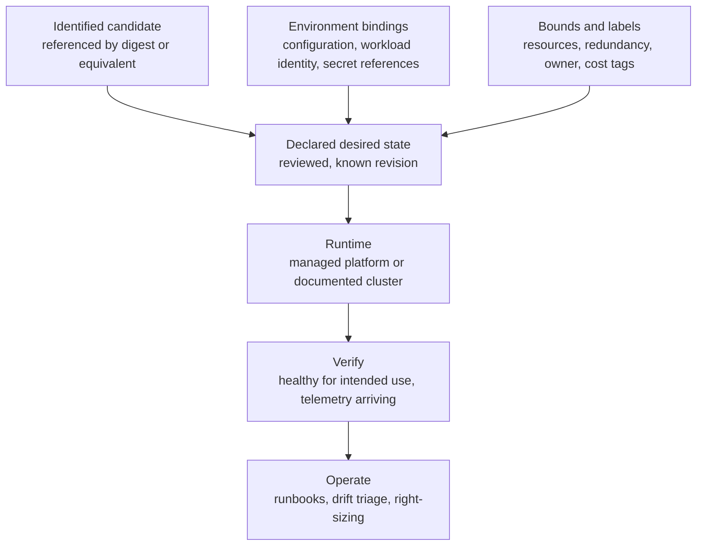

# Application Deployment

This reference answers **what does a production-ready application deployment look like?** It composes existing doctrine; it creates no new requirements.

If this reference conflicts with a canonical principle or owning pattern, the canonical owner wins and this reference is defective.

## Use When

Use this when describing or reviewing how a service or job runs in production: what runs, where, what is bound to it, how it is bounded and labelled, and who operates it. Building and promoting the candidate is [CI/CD Delivery](cicd-delivery.md); exposure and recovery are [Release And Rollback](release-and-rollback.md).

## Standard Shape

A deployment is a declaration with three inputs: one immutable candidate, the bindings that differ by environment, and the bounds and labels that make the workload governable.

## Invariants

These summarise the canonical owners below, including their applicability and exception paths.

1. **Immutable deployed unit:** deployment inputs for the application payload are immutable: a container digest or equivalent where images are in play. `latest` in production is a red flag unless policy allows it and it is auditable.
2. **Same artefact, bound per environment:** where the platform allows, the same built artefact runs in staging and production, with environment-specific configuration normally supplied at deploy or start time, not built in. Non-secret configuration can load from files or the environment; secrets are not baked into images. Staging or its equivalent normally exercises the same deploy path and checks as production, including how secrets are injected.
3. **Own identity, least privilege:** network location is not sufficient proof of authorisation. For estate-governed and production workloads, a short-lived, audience-scoped credential is the default wherever the target accepts federated or platform identity. The deploying pipeline's identity is scoped to what that pipeline needs.
4. **Declared and reviewed desired state:** material cluster- or account-level desired state changes through the version-control path or a governed import with an audit trail, and every material apply is tied to a known revision. Drift is measured and triaged.
5. **Deliberate runtime:** a vendor-managed application platform that meets security, networking, compliance, and scaling needs is preferred over operating a cluster for that workload. Choosing a cluster is a documented decision.
6. **Bounded capacity:** critical paths have latency and throughput expectations, and capacity plans connect traffic forecasts to autoscaling limits, quotas, and database headroom.
7. **Runtime shape:** a production workload normally signals liveness and readiness as separate questions, stops gracefully on a termination signal while tolerating abrupt stop, and declares the compute and memory it needs. A service with an availability objective normally runs more than one instance across the platform's failure domains. Where a managed platform provides a property, the team confirms and configures it.
8. **Owned, operable, and attributable:** each service or deployable unit has a named owner team, with an on-call or escalation path where applicable, and runbooks for deploy, rollback, common failures, and dashboards. Provisioned resources are tagged at creation with at least environment, owner team, cost centre, application, and product.
9. **Failure posture chosen in advance:** a third-party service inside a critical user journey gets explicit timeouts, circuit breaking, and a designed degraded mode. Where dynamic configuration is used, defaults are safe when the configuration service is unavailable: fail closed or last-known-good per product policy.
10. **Verification closes deployment:** deployment is incomplete until verification proves the deployed thing is healthy enough for its intended use. For production services on material paths, verification normally also checks that expected telemetry arrives.

## Normal Implementation

| Step | What the engineer does |
| --- | --- |
| Choose runtime | Take the managed path the estate catalogue names, or the platform golden path where one is published. Record the decision when cluster semantics are needed. |
| Package | For a container image: minimal, non-root by default, scanned in CI, base image pinned by digest. See [Dependency Adoption](dependency-adoption.md). |
| Declare | Write the deployment as reviewed desired state that references the candidate by digest or equivalent. |
| Bind | Supply environment-specific configuration at deploy or start time and bind the workload identity. A fallback secret stays in the secret store, not the image: [Secretless Workload Identity](secretless-workload-identity.md). |
| Bound and label | Set scaling limits and quotas from the capacity plan; declare resource needs, health signals, instance count, and spread; tag resources for ownership and cost. |
| Register | Where the estate keeps a service catalogue, record owner, escalation path, runtime, dependencies, SLOs or criticality, and runbooks. |
| Deploy | Apply the known revision through the deploy path staging uses. |
| Verify | Run smoke or readiness checks, confirm telemetry arrives on material paths, and keep the output as evidence: [Testing And Verification](testing-and-verification.md). |
| Operate | Walk the runbooks on their cadence, triage drift, and right-size from observed utilisation, with owner review and testing in production. |

## Common Variations

### Managed Application Platform

The platform owns more of the surface, and the estate catalogue names the blessed path per environment. Image discipline, secret handling, observability, and contracts do not change.

### Container Orchestration Platform

This applies only where the estate runs Kubernetes. The cluster baseline adds least-privilege access control for humans and CI, default-deny network policy between namespaces unless explicitly allowed, and restrictions on privileged pods, host namespaces, and dangerous capabilities. Image policy allows only trusted registries; admission control validates required labels, resource limits, and signed images where signing is adopted. A service mesh is optional.

### Workloads With Persisted Data

Recovery point and recovery time objectives are defined per data class, backups are automated, and restores are tested on a cadence. Where the product promises continuity, objectives for regional loss are explicit. During a rolling deploy old and new versions coexist, so the store stays valid for both: [Database Migration](database-migration.md).

### Major Launch Or Traffic Step

Load tests run before major launches or order-of-magnitude traffic changes, with realistic scenario mixes. A regression beyond a performance budget blocks release unless explicitly accepted with a rationale.

### Model-Calling Workloads

AI and ML workloads at Tier A or above carry explicit cost controls as part of the deployment checklist: token budgets, a daily-spend circuit breaker, a model selection policy, and cost-per-outcome tracking.

### Edge And Device Runtimes

Constrained devices can use lightweight runtimes instead of full clusters, with update, observability, and SBOM expectations recorded per fleet.

## Boundaries

- **Exposure and recovery:** flags, canary signals, who can roll back, and forward fixes belong to [Release And Rollback](release-and-rollback.md).
- **Signals and request limits:** what the service emits belongs to [Service Observability](service-observability.md); body size, timeouts, and rate limits belong to [Service API](service-api.md).
- **Workload lifecycle detail:** probe design, grace periods, replica counts, and CPU caps are platform and tooling choices. The owner states the properties, not the numbers.
- **Numbers and products:** utilisation targets, tag keys, and thresholds stay in their owners; runtimes, reconcilers, secret stores, and admission controllers are tooling.

## Canonical Doctrine

Layer contract: [Implementation References](README.md).

| Concern | Canonical principle or owning pattern |
| --- | --- |
| Same-artefact promotion, verification, evidence, and application repository shape | [Build Principles](../principles/build.md) §§5, 12; [Build Surface Model](../patterns/build-surface-model.md) |
| Parity, ownership, runbooks, and deploy identity | [Collaboration, Trunk-Based Delivery, And Operational Rigour](../principles/collaboration.md) §§6, 8–9 |
| Configuration versus secrets; deploy-time binding; safe dynamic defaults | [Configuration And Secrets](../principles/configuration-and-secrets.md) §§1, 3 |
| Location is not authorisation; secretless default | [Zero Trust And Workload Identity](../principles/zero-trust-and-workload-identity.md) §§1–2 |
| Runtime choice, image discipline, base-image digests, and edge runtimes | [Container Runtime Choice: Managed Platforms Vs Kubernetes](../principles/container-runtime-choice.md) §§1–3, 5; [Dependencies And Supply Chain](../principles/dependencies-supply-chain.md) §4 |
| Cluster baseline, mesh choice, image policy, and admission | [Kubernetes Platform Security](../principles/kubernetes-platform-security.md) §§1–3 |
| Desired state, known-revision applies, immutable inputs, and drift | [GitOps And Declarative Operations](../patterns/gitops-and-declarative-operations.md) §4 |
| Performance budgets, load tests, capacity, and right-sizing | [Performance, Load, And Cost](../principles/performance-and-cost.md) §§1–3 |
| Tagging, right-sizing review, and inference cost controls | [Cost, FinOps, And Unit Economics](../principles/cost-and-finops.md) §§2, 5, 7 |
| Runtime posture per critical dependency; workload runtime shape | [Reliability: SLOs, Error Budgets, And Incidents](../principles/reliability-slo-incidents.md) §§7–8 |
| Rolling-deploy overlap, recovery objectives, restores, and regional continuity | [Data, Migrations, Backups, And Recovery](../principles/data-and-migrations.md) §§1, 2, 4 |
| Telemetry verification; runbook cadence | [Observability](../principles/observability.md) §8; [Documentation And Organisational Knowledge](../principles/documentation-knowledge.md) §2 |
| Golden paths and service catalogue metadata | [Platform As Product, Golden Paths, And Service Catalog](../patterns/platform-as-product-and-golden-paths.md) §§2, 4 |
| Operability; failure designed before need | [Core Proposition 8](../../ENGINEERING.md#8-preserve-operability-and-learn-from-incidents), [Core Proposition 6](../../ENGINEERING.md#6-design-failure-retry-recovery-and-reconciliation) |

Tooling and verification: [Platform, SRE, And Extended Readiness Checklist](../checklists/platform-readiness.md) and [Release Readiness Checklist](../checklists/release-readiness.md).

Related references: [CI/CD Delivery](cicd-delivery.md), [Release And Rollback](release-and-rollback.md), [Secretless Workload Identity](secretless-workload-identity.md), [Service Observability](service-observability.md), [Database Migration](database-migration.md), and [Testing And Verification](testing-and-verification.md).

Decisions and evidence: [ADR 0048](../../docs/adr/0048-add-implementation-reference-layer.md), [ADR 0057](../../docs/adr/0057-close-owner-gaps-from-implementation-batch-3.md), and the [batch 3 owner audit](../evolution/research-impl-backlog-batch-3-composition-2026-11.md).
