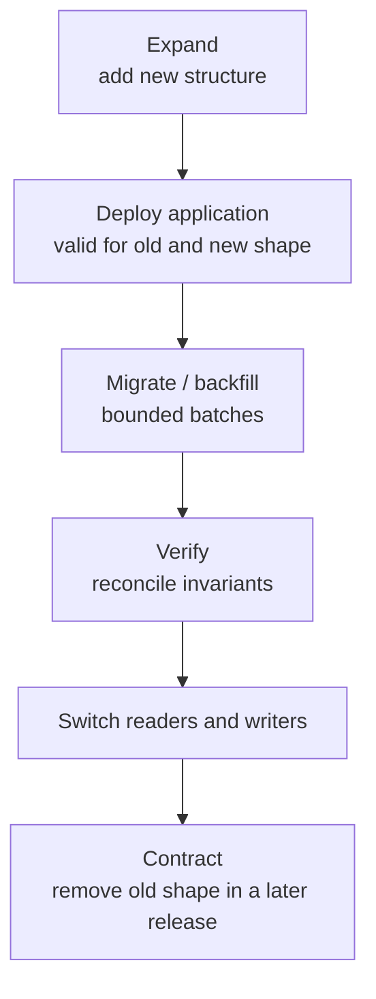

# Database Migration

This reference answers **how is a schema or persisted-data change made safely while the system keeps deploying?** It composes existing doctrine; it creates no new requirements.

If this reference conflicts with a canonical principle or owning pattern, the canonical owner wins and this reference is defective.

## Use When

Use this when adding, changing, or removing tables, columns, indexes, constraints, or document shapes, or when running a backfill or data correction against a live store. For where migration evidence sits in the delivery graph, continue to [Testing And Verification](testing-and-verification.md). Backups, restore objectives, and regional failover are owned separately by [Data, Migrations, Backups, And Recovery](../principles/data-and-migrations.md) §§2 and 4.

## Standard Shape

Each arrow is a checkpoint, not a single transaction. Old and new application versions run together during a rolling deploy, so the database must serve both until the old version is fully replaced. Recovery is a new forward migration or an application rollback; it is not a destructive down migration.

## Invariants

These summarise the canonical owners below, including their applicability and exception paths.

1. **Compatible overlap:** every production schema state is valid for both the running and the incoming application version.
2. **Expand, migrate, contract:** new structure arrives first, a compatible application is deployed, data is backfilled and verified, readers and writers switch, and the old path is removed last. Dangerous operations are split across releases with explicit checkpoints.
3. **Forward-only in production:** rollback is a new forward migration or an application rollback. A down migration that drops data is not a recovery plan.
4. **Bounded backfills:** data moves in batches with pauses and stop conditions on replica lag or lock wait. The limits are recorded in the migration note.
5. **Safety net before high risk:** take a snapshot or enable point-in-time recovery where the platform supports it. Review replica lag and lock duration for large tables.
6. **Re-runnable or recoverable:** a step tolerates re-run or no-op where feasible. Otherwise its checkpoint, restart, repair, or forward-recovery procedure exists before execution.
7. **Reconciled, not just executed:** recovery and reconciliation are defined before they are needed, and migrations receive risk-proportionate automated evidence. A runner exiting successfully does not prove the data is correct.
8. **High-risk review class:** the pull request states its forward and backward compatibility story, recovery or reversible steps, data volume, and lock risk, so informed reviewers can challenge it.
9. **Versioned assets, separate state:** migration scripts change through the normal reviewed path, and migration notes are release artefacts. Data promotion is its own deployable unit; the database is not a binary promoted between environments.

## Normal Implementation

| Step | What the engineer does |
| --- | --- |
| Plan | Classify the operation: additive, data-only, locking or rewriting, or destructive. Write a migration note covering phases, batch limits, stop conditions, recovery path, and verification. Check locking behaviour against the documentation for the deployed engine version. |
| Expand | Add new tables, nullable columns, or indexes using the engine's lower-locking options where available. Ship this step separately from destructive steps. |
| Deploy compatible code | Release application code that works with both shapes, for example by reading old and new or writing both, while the old version still runs. |
| Backfill | Run batched, resumable jobs while watching replica lag and lock wait. Halt or reduce batch size when the recorded thresholds are crossed. |
| Verify | Reconcile counts, constraints, and domain invariants between old and new shapes before anything depends on the new one. |
| Switch | Move readers and writers to the new shape. If a flag controls the switch, validate both variations as separate contract versions and keep the flag in its lifecycle. |
| Contract | After every running application version uses the new shape, remove the old structure in a later release. Take the snapshot or recovery point first where supported. |
| Close | Remove dual-read or dual-write code, retire the flag, and link the migration note from the release notes. |

Small additive changes often collapse into one release: expand only, with no backfill and no contract phase. Use the full sequence when a step can block, rewrite, or remove data that running code still needs.

## Common Variations

### Additive-Only Change

Adding a nullable column or a new table that no running code reads is the expand step alone. It still goes through review and the build, but needs no dual paths.

### Large Or Hot Tables

Index builds, constraint validation, and type changes on large tables can block traffic. Use the engine's documented online or concurrent options and stage constraints such as `NOT NULL`. Starting batch and pause defaults live in the owning principle and are tuned per engine and load.

### Data Correction Without Schema Change

A one-off fix to persisted data follows the same batching, stop conditions, reconciliation, and schema-and-migration review as a backfill.

### Rename Or Type Change

A rename is an expand to the new name, a dual-write period, a backfill, a switch, and a contract of the old name. A direct in-place rename breaks the running version.

### Documented Maintenance Window

Some estates accept a documented maintenance window instead of expand and contract. The window replaces the overlap sequence; forward-only change, safety nets, and an honest recovery path still apply.

### Externally Visible Shapes

When the stored shape is also an API field, event payload, or exported file, the external contract follows its own versioning and deprecation path. The database change cannot remove a field that consumers still receive.

### Retrieval Indexes And Embeddings

A change of embedding model, graph extraction, or extraction prompt is an index migration with golden-set regression, owned by the retrieval and AI systems doctrine rather than this reference.

## Boundaries

- **Engines and tools:** migration runners, online schema-change tools, and engine-specific DDL options are tooling. Verify behaviour against the deployed engine version.
- **Backups and disaster recovery:** a snapshot before a risky step is a safety net. It does not replace restore testing or regional recovery planning.
- **GitOps:** desired-state repositories describe infrastructure and configuration. Persisted data follows this reference and its owners; not all state belongs in Git.
- **Feature flags:** a flag can control which shape the code uses. It does not make a destructive schema change reversible.
- **Numbers:** batch sizes, pauses, thresholds, and deprecation windows remain in their owners and are tuned per estate.

## Canonical Doctrine

Layer contract: [Implementation References](README.md).

| Concern | Canonical principle or owning pattern |
| --- | --- |
| Rolling-deploy compatibility, expand and contract, forward-only change, batched backfills, snapshots, and recovery honesty | [Data, Migrations, Backups, And Recovery](../principles/data-and-migrations.md) §§1, 3 |
| Re-runnable steps and defined recovery for non-idempotent transitions | [Idempotency Across Boundaries](../patterns/idempotency-across-boundaries.md) §4 |
| Recovery and reconciliation designed before need | [Core Proposition 6](../../ENGINEERING.md#6-design-failure-retry-recovery-and-reconciliation) |
| Risk-proportionate evidence for migrations and data integrity | [Testing Strategy](../principles/testing-strategy.md) §4 |
| Schema and migration review class | [Code Review And Change Approval](../patterns/code-review-and-change-approval.md) §5 |
| Data promotion as a deployable unit and migration notes as release artefacts | [Build Principles](../principles/build.md) §§4, 7 |
| Flag-controlled schema variations and flag retirement | [Feature Flag Governance](../patterns/feature-flag-governance.md) §7 |
| External API and event contract evolution | [Semantic Versioning Policy](../principles/semantic-versioning.md) §§6–9, [Event And Message Contracts](../principles/event-contracts.md) |
| Desired state versus persisted state | [GitOps And Declarative Operations](../patterns/gitops-and-declarative-operations.md) |
| Index and embedding migrations | [RAG Retrieval Baseline](../patterns/rag-retrieval-baseline.md), [AI And ML-Assisted Systems](../principles/ai-ml-systems.md) §7 |

Tooling and verification: [Platform Readiness](../checklists/platform-readiness.md), which also records the maintenance-window alternative, and [Release Readiness](../checklists/release-readiness.md).

Related references: [Testing And Verification](testing-and-verification.md), [CI/CD Delivery](cicd-delivery.md), and [Branching And Integration](branching-and-integration.md).

Decisions and evidence: [ADR 0048](../../docs/adr/0048-add-implementation-reference-layer.md) and the [composition research note](../evolution/research-impl-reference-batch-composition-2026-11.md).
