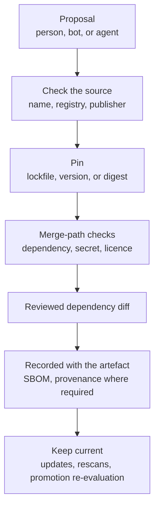

# Dependency Adoption

This reference answers **can a third-party package, image, model, dataset, or tool be admitted, and how is it kept current?** It composes existing doctrine; it creates no new requirements.

If this reference conflicts with a canonical principle or owning pattern, the canonical owner wins and this reference is defective.

## Use When

Use this when a person, update bot, or coding agent proposes a third-party library, base image, model, dataset, skill, or tool server, or when a pull request changes a dependency manifest or lockfile. Evidence placement continues in [Testing And Verification](testing-and-verification.md); promotion-time re-evaluation sits in [CI/CD Delivery](cicd-delivery.md).

## Standard Shape

A dependency enters through the same merge path as code: pinned, scanned, reviewed, and recorded against the artefact that ships it. Scheduled scanning and promotion re-check it later, so admission is not a single event. The order is usual, not fixed, except that a model- or agent-suggested package is checked before installation.

## Invariants

These summarise the canonical owners below, including their applicability and exception paths.

1. **Locked resolution:** applications commit a lockfile; libraries follow their ecosystem's documented norm. CI validates lockfile integrity, and a regenerated lockfile that differs from the committed one fails the build.
2. **Digests where references move:** base images are referenced by digest, not mutable tag. Models and datasets in production or estate-governed use are pinned by version and content digest from a declared source.
3. **Enforced checks:** dependency and secret scanning run on every merge path and on a schedule, covering what ships or influences deployment. A check claimed as a merge requirement is platform-enforced and fails the merge path on violation. Allowlists are explicit, documented, and reviewed periodically.
4. **Licence policy:** distributed software has an open-source licence allowlist or policy, with attribution files where required.
5. **Reviewed diff:** new dependencies are called out as a review hotspot. In agent-authored pull requests, dependency and lockfile diffs get explicit human review, and agents do not regenerate a lockfile unless explicitly asked.
6. **AI-proposed packages checked before install:** in estate-governed and production delivery paths, a package first suggested by a model or agent is checked against the intended registry before installation for existence, registry age, publisher identity, and download history. The same lookup is recommended for local single-user development.
7. **Evidence with the artefact:** artefacts shipped externally, to regulated environments, or under a legal, contractual, or policy demand carry a machine-readable SBOM attached at build time; other production artefacts normally do too. Provenance follows the owning principle's SLSA targets, and transparency artefacts that law, contract, or policy demands are release inputs.
8. **Kept current:** update pull requests are automated. Update classes the estate defines as low risk can merge on a documented bot-only path once required checks pass; other updates are human-reviewed. Security fixes meet the estate's published severity targets, with known-exploited issues most urgent. Promotion re-checks the exact artefact against current advisories; a green merge does not authorise promotion past a new disclosure without a scoped exception or exploitability record.
9. **Bounded exceptions:** risk acceptances carry an owner, expiry, and compensating control. Silent indefinite waivers count as control failure.

## Normal Implementation

| Step | What the engineer does |
| --- | --- |
| Propose | Describe why it is needed and how to verify it; flag it as a review hotspot. |
| Check the source | For internal libraries, use scoped names where the ecosystem supports them and resolve from the private registry first. Look up agent-suggested names in the registry before installing; the lookup is the evidence. |
| Pin | Add through the package manager, commit the lockfile, and reference images, models, and datasets by digest. |
| Check | Let required checks run dependency, secret, and licence scanning across inputs that influence delivery, plus any dependency-review gate. |
| Review | Read the called-out change with intent to merge. Review agent-authored dependency and lockfile diffs explicitly. |
| Merge | Merge on passing required checks, or record a time-bounded exception for a merge-blocking finding. |
| Record | Let the build attach the SBOM, update attribution files where licences require them, and retain scan evidence. |
| Keep current | Review update pull requests, patch within severity targets, and plan breaking upgrades as work rather than drift. |

## Common Variations

### Container Images

Verify the base-image digest before pull in security-sensitive pipelines, and keep images minimal, non-root by default, and scanned in CI. Images shipped externally or deployed to production are normally signed, keyless through the pipeline's short-lived identity where supported, and the signature is verified at deploy against the identity and issuer permitted to sign, with provenance checked against the expected builder and source where it is used. Attach the SBOM to the image digest. On container orchestration platforms, image policy allows only trusted registries, and admission validates signed images where adopted.

### AI-Proposed Packages

An attacker can register a name a model invented; it then installs legitimately with a consistent lockfile, so scoped names, registry precedence, lockfile checks, and post-resolution scanning miss it. Dependency-review gates and lockfile-diff review surface the diff but are not the test. A curated registry allowlist or private proxy, with install scripts disabled by default, keeps unknown names from resolving. Exceptions are bounded and expiring, with lockfile-diff review and a registry allowlist as the compensating control.

### Models And Datasets

Locally loaded embedding and reranker models count too. Admission rests on verified publisher identity, not download counts or trending placement. Where the publisher signs, verify the signature and its transparency-log entry before first use. Production loading uses non-executable weight formats; a pickle-class artefact loads only through sandboxed deserialisation under a recorded, expiring exception, and a clean scan does not make it safe. Ingest scanning and an AIBOM-class record are recommended. Datasets behind production models carry per-revision provenance. The consuming system's owner owns this evidence.

### Agent Skills And Tool Servers

Agent definitions, skills, and tool-server configurations steering automation that can read secrets, mutate production, publish packages, or alter downstream systems, on the merge path or with standing credentials, share pipeline code's trust class: protected paths, no self-review, an informed reviewer. Third-party skills and servers also pass dependency admission, with provenance and version or digest pinning. Instruction files used only by an interactive assistant under the developer's own authority are ordinary repository content; review hygiene still applies. Host registry posture and protocol-revision pinning stay with the AI and ML-assisted systems principle.

### Updates And Disclosures

Bot-opened updates pass the same required checks. Auto-merge is limited to documented bot-only paths that estate policy allows. For a new advisory, remediate, block, or release under an explicit risk acceptance. Where the shipped configuration is not exploitable, record a scoped VEX or equivalent statement and re-evaluate when code or reachability changes.

## Boundaries

- **Numbers:** example severity targets and SLSA levels stay in their owners.
- **Hosted model APIs:** runtime dependencies under reliability and provider-continuity doctrine, not artefact admission.
- **Contractual boundaries:** a revision-pinned control profile records dependencies inside a declared contractual or regulatory boundary.

## Canonical Doctrine

Layer contract: [Implementation References](README.md).

| Concern | Canonical principle or owning pattern |
| --- | --- |
| Pinning, updates, SBOM, provenance, signing, licensing, registry hygiene, and model and dataset admission | [Dependencies And Supply Chain](../principles/dependencies-supply-chain.md) §§1–8 |
| AI-proposed package gate, external model APIs, and tool-protocol posture | [AI And ML-Assisted Systems](../principles/ai-ml-systems.md) §§4, 6–7 |
| Merge-path dependency analysis and vulnerability response | [Secure Development Lifecycle And Vulnerability Response](../principles/secure-development-lifecycle.md) §§2–3 |
| Enforced gates, agent-definition boundary, exceptions, and promotion re-evaluation | [Merge Path Evidence And Pipeline Integrity](../principles/merge-path-evidence-and-pipeline-integrity.md) §§1–2 |
| Review hotspots, merge blockers, agent-definition class, and agent-authored diffs | [Code Review And Change Approval](../patterns/code-review-and-change-approval.md) §§1, 3, 5, 6 |
| Release artefacts, delivery-graph scanning, allowlists, evidence, and provenance | [Build Principles](../principles/build.md) §§7, 10, 12, 14 |
| Dependency updates and breaking upgrades | [Collaboration, Trunk-Based Delivery, And Operational Rigour](../principles/collaboration.md) §9 |
| Image hygiene and signed-image admission | [Container Runtime Choice: Managed Platforms Vs Kubernetes](../principles/container-runtime-choice.md) §3, [Kubernetes Platform Security](../principles/kubernetes-platform-security.md) §3 |
| Exception record | [Normative Language, Applicability, And Exceptions](../patterns/normative-language-applicability-and-exceptions.md#5-exception-contract) |
| Contractual and regulatory dependency boundaries | [Revision-Pinned External Control Profiles](../patterns/revision-pinned-control-profiles.md) |

Tooling and verification: [Dependency Automation Tooling](../tooling/dependency-automation.md), [Merge Path And Pipeline Control Suite](../tooling/merge-path-and-pipeline-control-suite.md), [Build Readiness](../checklists/build-readiness.md), and [Release Readiness](../checklists/release-readiness.md).

Related references: [CI/CD Delivery](cicd-delivery.md), [Testing And Verification](testing-and-verification.md), and [Service API](service-api.md).

Decisions and evidence: [ADR 0048](../../docs/adr/0048-add-implementation-reference-layer.md) and the [composition research note](../evolution/research-impl-backlog-batch-2-composition-2026-11.md).
