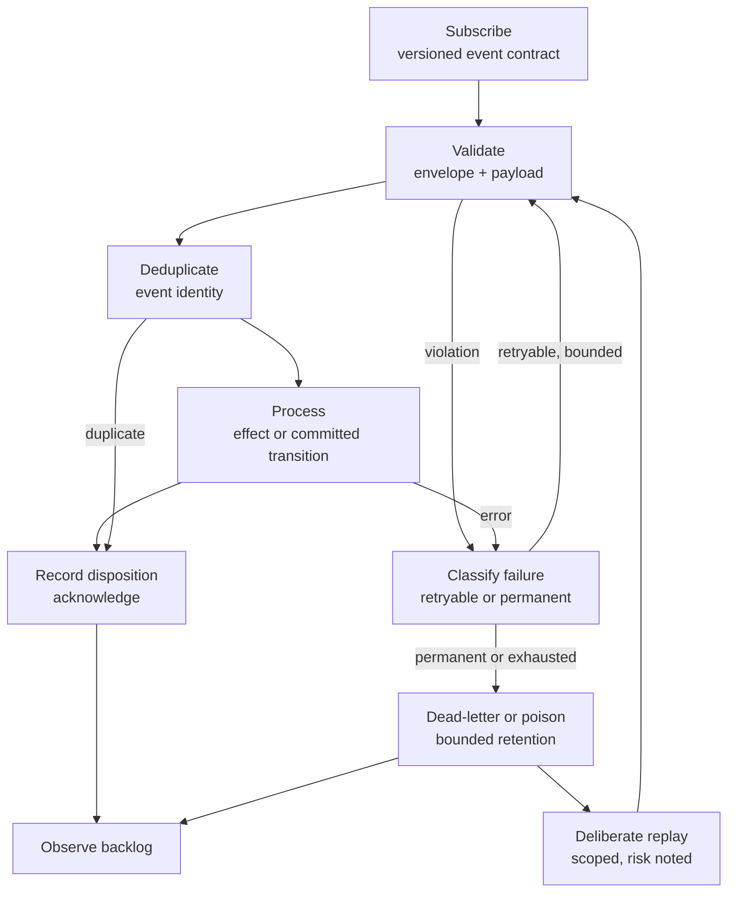

# Event Consumer

This reference answers **how are messages consumed and failures recovered?** It composes existing doctrine; it creates no new requirements.

If this reference conflicts with a canonical principle or owning pattern, the canonical owner wins and this reference is defective.

## Use When

Use this when adding or changing a component that consumes messages from a queue, topic, bus, or stream, or that receives event-carrying HTTP callbacks. For defining or evolving the contract itself, start from [Event And Message Contracts](../principles/event-contracts.md). For synchronous endpoints, use [Service API](service-api.md).

## Standard Shape

Delivery is treated as at-least-once, so any arrow can run more than once for the same event. The consumer stays correct because duplicates are handled at the controlling boundary, not because the channel promises single delivery. Acknowledgement comes after the effect is durable, so a crash leads to redelivery rather than loss; acknowledgement modes, delivery limits, and redelivery timing are channel settings described in tooling.

## Invariants

These summarise the canonical owners below, including their applicability and exception paths.

1. **Contract first:** each event type the consumer relies on has a named, versioned contract: an envelope plus a separate payload schema, with documented ordering, retry, and idempotency expectations. Fixtures are validated against schemas in CI where the toolchain allows.
2. **Portable envelope, scoped identity:** CloudEvents is the portable default envelope for new event boundaries; a documented equivalent is valid when it preserves the envelope semantics. Under CloudEvents the event identity is the `source` + `id` pair, not `id` alone.
3. **Violations are failures:** a contract violation at the boundary is a failure, not only a log line, unless a documented degradation path exists.
4. **At-least-once by default:** assume at-least-once delivery unless end-to-end single-commit semantics are proven. Business-level exactly-once is not inferred from a transport or broker claim; the application states the duplicate and recovery invariant it actually enforces.
5. **Deduplicate before non-idempotent effects:** where at-least-once delivery applies, deduplication on the stable event identity happens before any irreversible or non-idempotent effect. Where the effect is non-idempotent and a duplicate could cause material harm, the controlling boundary prevents or detects duplicate business effects; for material effects it retains the first disposition for the redelivery window.
6. **Classified failures:** consumer handling distinguishes retryable from permanent failures, and what makes a message non-retryable is documented.
7. **Bounded retry, then dead-letter:** after repeated failures or a non-retryable error, the message moves to a separate dead-letter or poison destination rather than retrying forever. Retention there is bounded, with alerting before loss.
8. **Deliberate replay:** replay is an operator action with a stated scope (single id, batch, or time window) and a risk note on duplicate side effects. Where consumers assume ordering, the note calls out that replay can violate it.
9. **Acknowledge after the effect:** the consumer acknowledges, or commits its position, only after the effect is durable. Where losing the effect would cause material harm, that order is required; acknowledging first is an at-most-once choice the consumer documents.
10. **Observable backlog:** production message paths expose backlog signals and correlate messages with traces. Where processing latency matters to users, an SLO covers lag or time-to-handle, not only API latency.

## Normal Implementation

| Step | What the engineer does |
| --- | --- |
| Subscribe | Bind to the versioned event types handled. Note the envelope version and serialisation the estate supports, the identity scope, and the documented ordering and delivery semantics. |
| Validate | Check envelope and payload against the contract. The owner's examples of non-retryable messages are schema violations, oversize payloads, and unknown types. |
| Deduplicate | Look up the event identity. Choose a mechanism: recorded first outcome, conditional state transition, delivery deduplication, or an idempotent effect. |
| Process | Apply the effect. When the message drives a workflow, the transition commits when durable state matches the new state and downstream effects are applied, scheduled, or outboxed. |
| Acknowledge | Settle the message through the channel's own mechanism only after the effect is durably committed, scheduled, or outboxed. Acknowledging first is an at-most-once choice to document. |
| Fail | Retry retryable failures a bounded number of times; route permanent failures and exhausted retries to the dead-letter or poison destination. |
| Replay | Replay deliberately, with scope and risk note. |
| Observe | Emit depth age, dead-letter rate, processing lag, and retry count per event type. Correlate `id`, `type`, and `subject` onto spans and keep high-cardinality identifiers off metric labels. Keep an actionable runbook for dead letters and replay. |
| Evolve | Additive changes are preferred; a breaking change arrives as a new event type or version suffix with a migration plan. |

## Common Variations

### HTTP Callback Consumers

Third-party callbacks are untrusted until verified. Authenticate the sender with a signature over the raw body or with mutual TLS, reject deliveries outside a short timestamp window unless relying on idempotent deduplication alone, store processed delivery ids, and tolerate duplicates. Apply TLS, rate limits, and size limits; source address allowlists are defence in depth, not the sole authentication. Rotate signing secrets with overlapping verification windows.

### Documented Equivalent Envelope

A broker-native, protocol-specific, constrained, or legacy envelope is valid when it preserves the envelope semantics. Record its schema, identity scope, delivery behaviour, compatibility rationale, and mapping boundary, and deduplicate on that identity scope. A similar shape does not establish CloudEvents conformance.

### Ordered Or Keyed Consumption

If the consumer assumes per-key ordering, document the partition key. Competing consumers on a shared queue have no global order. For callbacks where ordering matters, define per-entity serialisation or version fields in the payload.

### Workflow And Saga Consumers

When a message drives a state transition, the model is explicit, including terminal and error states and their recovery paths. Every wait state has a maximum dwell time and a defined next state: capped retry, human escalation, cancellation, or dead-letter. A flow spanning several transactional boundaries with partial failure documents forward recovery or compensation per step; a single-service ACID transaction needs no saga notation. Human approvals are audited and idempotent when re-posted.

### Projections And Read Models

A read model built from events documents its ordering assumptions and lag tolerance, and has a path to rebuild or reconcile from history or an authoritative store, because replay re-delivers old events.

### Consumers That Also Publish

An outbox can commit business state and the outbound event in one transaction, with the publisher retrying from it. Downstream consumers still deduplicate.

## Boundaries

- **Brokers and SDKs:** acknowledgement modes, delivery limits, redelivery delays, and consumer libraries are tooling. The invariants hold on any channel.
- **Contract authorship:** designing, versioning, or replacing an envelope or event type belongs to the contract owners; this reference starts at subscription.
- **Numeric defaults:** retry counts, backoff, dwell times, timestamp windows, and dead-letter retention remain in their owners or tooling and are tuned per estate.

## Canonical Doctrine

Layer contract: [Implementation References](README.md).

| Concern | Canonical principle or owning pattern |
| --- | --- |
| Versioned, validated event boundaries | [Core Proposition 4](../../ENGINEERING.md#4-define-and-verify-material-boundaries) |
| Event contracts, envelope default, `source` + `id` identity, ordering and delivery semantics, envelope replacement | [Event And Message Contracts](../principles/event-contracts.md) §§1–4, 6–7 |
| Envelope conformance | [Interoperability, Standards, And Vendor Reality](../principles/interoperability-and-standards.md) §1 |
| Acknowledgement order, dead-letter, poison, replay, ordering, deduplication identity, backlog metrics | [Message Channel Operations](../patterns/message-channel-operations.md) |
| Duplicate handling, no inferred exactly-once, outbox | [Idempotency Across Boundaries](../patterns/idempotency-across-boundaries.md) §§1, 3 |
| Retry, recovery, and reconciliation designed before need | [Core Proposition 6](../../ENGINEERING.md#6-design-failure-retry-recovery-and-reconciliation) |
| Retryable versus permanent failures | [Errors And Failure Modes](../principles/errors-and-failure-modes.md) §1 |
| Transitions, projections, sagas, wait states, human steps | [State Machines, Workflows, And Event Emission](../principles/state-machines-and-workflows.md) §§1–5 |
| Inbound third-party callbacks | [Webhook Ingress Security](../patterns/webhook-ingress-security.md) §§1–4 |
| Event fixtures in CI | [Testing Strategy](../principles/testing-strategy.md) §2 |
| Correlation and cardinality | [Observability](../principles/observability.md) §§2–3 |
| Runbooks for material paths | [Core Proposition 8](../../ENGINEERING.md#8-preserve-operability-and-learn-from-incidents) |

Tooling and verification: [CloudEvents Tooling](../tooling/cloudevents.md), [NATS And JetStream (Illustrative Tooling)](../tooling/nats-jetstream.md), [Kafka And CloudEvents (Illustrative Tooling)](../tooling/kafka-and-cloudevents.md), worked fiction in [Example: Order Workflow On JetStream (Fiction)](../patterns/example-order-jetstream-workflow.md) and [Example: Payment Saga Across Services (Fiction)](../patterns/example-saga-payment-workflow.md), [Build Readiness](../checklists/build-readiness.md), and [Platform Readiness](../checklists/platform-readiness.md).

Related references: [Service API](service-api.md), [Service Observability](service-observability.md), [Database Migration](database-migration.md), and [Testing And Verification](testing-and-verification.md).

Decisions and evidence: [ADR 0048](../../docs/adr/0048-add-implementation-reference-layer.md) and the [composition research note](../evolution/research-impl-backlog-batch-2-composition-2026-11.md).
