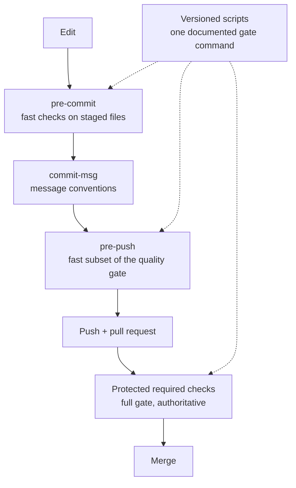

# Local Checks With Git Hooks

This reference answers **how should a repository use Git hooks to catch mistakes before review without treating them as enforcement?** It composes existing doctrine; it creates no new requirements.

If this reference conflicts with a canonical principle or owning pattern, the canonical owner wins and this reference is defective.

## Use When

Use this when adding or changing a repository's hook setup, or when deciding what runs before commit, before push, and in CI. For where every kind of check belongs across the delivery graph, continue to [Testing And Verification](testing-and-verification.md).

## Standard Shape

Hooks and CI call the same versioned scripts. Hooks run the fast part early, on the contributor's machine; protected required checks run the whole gate on the server and decide the merge.

## Invariants

These summarise the canonical owners below, including their applicability and exception paths.

1. **Feedback, not enforcement:** a check claimed as a merge requirement is enforced by platform configuration. Local-only scripts do not satisfy merge enforcement, because hooks can be absent, stale, misconfigured, or skipped.
2. **Same scripts as CI:** hooks call the repository's versioned scripts or task runner, not separate logic, so a local failure reproduces the CI failure. Every mandatory CI gate is runnable locally with one documented command.
3. **Same tool versions:** hooks use the pinned tool versions CI uses, so a local pass means the same thing as a CI pass.
4. **Fast inner loop:** hooks run the fast, deterministic subset. Slower checks move to pre-push or stay in CI, and the full gate always runs in CI.
5. **Discoverable, idempotent setup:** the hook set lives in tracked files and is installed by the documented setup step, which can be re-run safely.
6. **Secrets caught early, still caught late:** a pre-commit secret scan is the earliest catch; secret scanning before merge still runs. A secret that reached a shared remote is treated as exposed and rotated.
7. **Same gates for agents:** agent-authored changes face the same required checks and review as human changes. Where an agent commits in a local workspace, giving it the same hooks gives it the same early feedback.

## Normal Implementation

| Step | What the engineer does |
| --- | --- |
| Choose | List what the documented quality gate runs. Pick the fast, deterministic subset for hooks; leave network-dependent, slow, or flaky checks to CI. |
| Version | Keep hook scripts in a tracked directory. Git's default hooks directory sits inside the repository's administrative directory, outside tracked files, so point Git at the tracked directory during setup or use a hook manager whose configuration and versions are committed. |
| Wire | **pre-commit:** formatting, linting, and secret scanning on staged files. **commit-msg:** message format and any trailer conventions the repository uses. **pre-push:** fast tests and contract checks on the outgoing commits. |
| Install | Make hook installation part of the idempotent setup command, so a new contributor gets it on day one and anyone can repair it by re-running setup. |
| Keep CI authoritative | Map each required check to the documented gate and run the full gate on every pull request, whether or not hooks ran. |
| Maintain | Watch hook runtime. When a hook gets slow, move its check to pre-push or CI rather than training people to skip it. |

Keep a hook's output actionable: name the failing check and the command that reproduces it.

## Common Variations

### Large Or Multi-Unit Repositories

Scope hook checks to changed paths and the deployable units they touch, matching how CI path filters reflect ownership. Avoid running the whole repository's suite on every commit.

### Third-Party Hook Managers

A hook manager is a tool like any other in the gate. Commit its configuration, pin the versions of the hooks it fetches, and make CI run the same configuration so the two cannot drift.

### Commit Message Conventions

A commit-msg hook can check message shape, issue references, or a method-record trailer where the estate uses commit trailers to carry that record. It gives early feedback; any required convention is still verified server-side.

### Repositories Without Hooks

Hooks are optional. A repository with a fast documented gate command and authoritative required checks meets the same intent. Add hooks when they shorten feedback, not as a compliance item.

### Coding Agents And Parallel Workspaces

Agents running in isolated workspaces should run the same hooks and gate command as people. Confirm the hook configuration applies in each workspace you use; see [Parallel Work In Git Worktrees](git-worktrees.md).

## Boundaries

- **Not a security boundary:** contributors control their own machines. Hooks reduce accidents; they do not stop a determined bypass. The protected merge path does that.
- **Not an audit record:** a hook passing locally leaves no evidence the server can trust. Evidence comes from required checks bound to the revision.
- **Server-side hooks are different:** hooks or rules that run on the hosting platform are part of merge enforcement and are configured with the platform's branch protection, not with local hooks.
- **Hook code is code:** hooks run automatically on contributors' machines. Changes to them go through the same review as other repository changes.
- **Emergencies:** skipping a local hook is not a break-glass path. Emergency merges follow the documented, audited emergency process.
- **Products:** hook managers, scanners, and linters are tooling choices; this reference names capabilities.

## Canonical Doctrine

Layer contract: [Implementation References](README.md).

| Concern | Canonical principle or owning pattern |
| --- | --- |
| Merge requirements enforced by platform configuration; local scripts are not enforcement | [Merge Path Evidence And Pipeline Integrity](../principles/merge-path-evidence-and-pipeline-integrity.md) §2 invariant 1 |
| Versioned scripts, one documented local gate command, idempotent setup | [Build Principles](../principles/build.md) §§1–3 |
| Fast inner loop, local equivalents of CI gates, bypass pressure | [Developer Experience](../principles/developer-experience.md) §§1–2 |
| Split fast pre-push from full pre-merge | [Adoption Playbook](../patterns/adoption-playbook.md) §8 |
| Pinned tool versions and reproducible resolution | [Dependencies And Supply Chain](../principles/dependencies-supply-chain.md) §1 |
| Secret scanning in the build model; secrets never committed; rotation after exposure | [Build Principles](../principles/build.md) §10, [Configuration And Secrets](../principles/configuration-and-secrets.md) §§2, 4 |
| Protected trunk and required checks | [Collaboration](../principles/collaboration.md) |
| Method record and its transport | [Code Review And Change Approval](../patterns/code-review-and-change-approval.md) §6.1 |
| Agent-authored changes face the same gates | [AI And ML-Assisted Systems](../principles/ai-ml-systems.md) §4 |
| Local evidence versus authoritative evidence | [Testing Strategy](../principles/testing-strategy.md) |

Tooling and verification: [Collaboration Tooling](../tooling/collaboration.md#version-controlled-git-hooks), [Scanners And Quality Gates](../tooling/scanners-and-quality-gates.md), [Build Readiness](../checklists/build-readiness.md), [Collaboration Readiness](../checklists/collaboration-readiness.md), and the [Developer Experience Scorecard](../checklists/developer-experience-scorecard.md).

Related references: [Testing And Verification](testing-and-verification.md), [Branching And Integration](branching-and-integration.md), and [Parallel Work In Git Worktrees](git-worktrees.md).

Decisions and evidence: [ADR 0048](../../docs/adr/0048-add-implementation-reference-layer.md) and the [composition research note](../evolution/research-git-local-workflow-impl-composition-2026-11.md).
