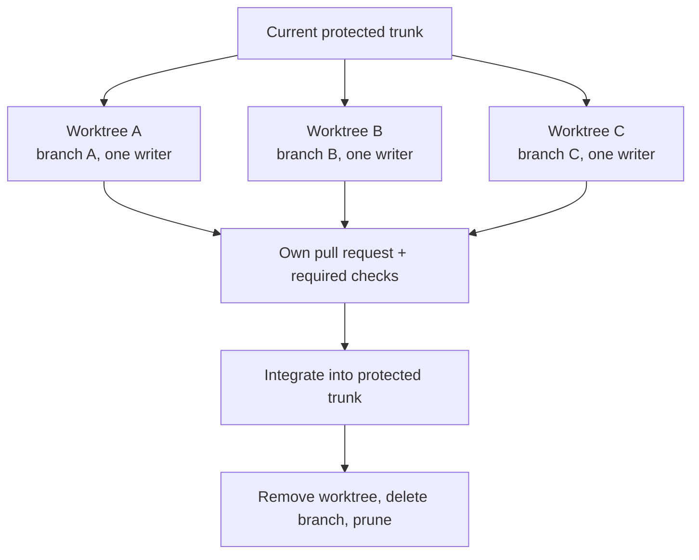

# Parallel Work In Git Worktrees

This reference answers **how do I run several changes at once, my own or parallel coding agents', without them interfering?** It composes existing doctrine; it creates no new requirements.

If this reference conflicts with a canonical principle or owning pattern, the canonical owner wins and this reference is defective.

## Use When

Use this when you need more than one change in flight in the same repository: a feature plus an urgent fix, a long test run while you keep editing, a local review of someone else's branch, or several agents working in parallel. For the branching and integration model itself, start with [Branching And Integration](branching-and-integration.md).

## Standard Shape

A linked worktree is a second checkout of the same repository. Branches, tags, history, and repository configuration are shared; each worktree has its own checked-out files, `HEAD`, and staging index. Git refuses by default to check out one branch in two worktrees, which keeps each change on its own branch.

## Invariants

These summarise the canonical owners below, including their applicability and exception paths.

1. **One change, one branch, one worktree:** each worktree holds a short-lived topic branch from current trunk that becomes one reviewable change.
2. **One writer per worktree:** a person or a single agent owns each mutable workspace. Parallel writers use separate worktrees and a named integration step, never each other's files.
3. **Same integration path:** each worktree's change goes through the same review and required checks. A worktree creates no authority and no shortcut to trunk.
4. **Local gate in every worktree:** each worktree runs the documented, idempotent setup and the local quality gate before its change is pushed.
5. **Files are isolated; nothing else is:** worktrees isolate checked-out files only. Credentials, local services, ports, databases, and deployment targets are shared unless something else separates them.
6. **Short-lived and cleaned up:** remove a worktree when its branch merges or is abandoned, and prune stale metadata, so abandoned work does not become a hidden integration line.

## Normal Implementation

| Step | What the engineer does |
| --- | --- |
| Start | Fetch, then add a worktree at a sibling path on a new branch from current trunk. Name the directory after the change so it is easy to find and remove. |
| Set up | Run the repository's idempotent setup in the new worktree. Dependencies and build outputs are per worktree; local configuration values stay outside source control. |
| Work | Keep one writer in the worktree. Commit on its branch and run the local gate; confirm the repository's hooks run here too. |
| Integrate | Push and open a pull request from that branch. Required checks and review decide the merge, exactly as for any other branch. |
| Clean up | After merge or abandonment, remove the worktree, delete the branch, and prune leftover worktree metadata. |

Because refs are shared, fetching or creating a branch in one worktree is visible in all of them. `HEAD` and the index are per worktree, so checkout, staging, and reset act on the current worktree; a rebase rewrites the branch ref, which the other worktrees see.

## Common Variations

### Parallel Coding Agents

Give each agent its own worktree and branch from the same trunk snapshot, record that snapshot, and keep each agent's authority within what its parent task allowed. Merge results through pull requests or a named integration step with an owner. Worktrees do not separate agent credentials or side effects: run agents that need that isolation in a sandbox or separate environment with scoped, per-task credentials.

### Urgent Fix While A Feature Is In Progress

Add a worktree from the affected release tag, following the hotfix path, so the in-progress feature stays untouched. Merge the fix back to trunk.

### Reviewing Or Testing Someone Else's Branch

Check the branch out in a temporary worktree, run its gate or reproduce the issue, then remove the worktree. Your own uncommitted work is not disturbed.

### Long-Running Tasks

Run a slow test suite, build, or benchmark in one worktree while you keep editing in another. Watch for shared local resources such as ports and databases.

### Separate Clones

Use a separate clone when a change needs a different repository configuration, hook set, or remote, or when it must not share refs with your other work. Clones are equally valid; worktrees are cheaper because they share history.

### Large Repositories

Per-worktree configuration and sparse checkout can keep each worktree small. Treat them as tooling choices and keep the local gate's behaviour the same.

## Boundaries

- **Not a branching strategy:** worktrees change where work sits on disk, not how it integrates. Trunk remains the integration line.
- **Not a security sandbox:** worktrees share the user's identity, environment, and repository. Isolation for untrusted or autonomous work comes from other mechanisms.
- **Not an environment:** a worktree is not staging or a deployment target, and its state is not evidence of what is running anywhere.
- **Agent orchestration:** delegation limits, budgets, and typed handoffs for parallel agents are owned by the agentic-loop and run-contract doctrine, not by this reference.
- **Commands:** worktree commands and naming conventions are tooling; see the tooling route below.

## Canonical Doctrine

Layer contract: [Implementation References](README.md).

| Concern | Canonical principle or owning pattern |
| --- | --- |
| Short-lived topic branches, protected trunk, small changes | [Collaboration](../principles/collaboration.md), [Trunk Workflow And Delivery Surfaces](../patterns/trunk-workflow.md) |
| One writer per mutable workspace, immutable inputs, attenuated authority, named integration | [Agentic Loop Design](../patterns/agentic-loop-design.md) §§8.3–8.4 |
| Short-lived isolated workspace for agent-produced candidates; no protected-branch mutation | [AI-Native Software Development Lifecycle](../patterns/ai-native-software-development-lifecycle.md) §§3, 10 |
| Governed execution, capabilities, and authority for agent runs | [Run Contracts](../patterns/run-contracts.md) |
| Idempotent setup and one documented local gate | [Build Principles](../principles/build.md) §3, [Developer Experience](../principles/developer-experience.md) §2 |
| Merge requirements enforced server-side | [Merge Path Evidence And Pipeline Integrity](../principles/merge-path-evidence-and-pipeline-integrity.md) §2 invariant 1 |
| No ambient credentials; per-task agent credentials | [Zero Trust And Workload Identity](../principles/zero-trust-and-workload-identity.md) §§2, 2.1 |
| Local configuration values outside source control | [Configuration And Secrets](../principles/configuration-and-secrets.md) §4 |
| Hotfix branch from the release tag and merge back | [Trunk Workflow And Delivery Surfaces](../patterns/trunk-workflow.md) |

Tooling and verification: [Collaboration Tooling](../tooling/collaboration.md#concurrent-local-work), [AI-Assisted Development Tooling](../tooling/ai-assisted-development.md), [Collaboration Readiness](../checklists/collaboration-readiness.md), and [AI-Native SDLC Readiness](../checklists/ai-native-sdlc-readiness.md) for parallel agent work.

Related references: [Branching And Integration](branching-and-integration.md), [Local Checks With Git Hooks](git-hooks.md), and [Secretless Workload Identity](secretless-workload-identity.md).

Decisions and evidence: [ADR 0048](../../docs/adr/0048-add-implementation-reference-layer.md) and the [composition research note](../evolution/research-git-local-workflow-impl-composition-2026-11.md).
