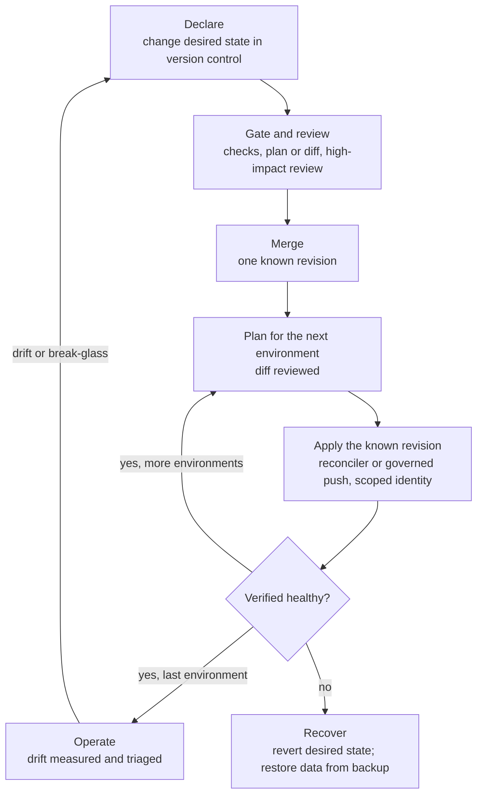

# Infrastructure Delivery

This reference answers **how should infrastructure changes move through environments?** It composes existing doctrine; it creates no new requirements.

If this reference conflicts with a canonical principle or owning pattern, the canonical owner wins and this reference is defective.

## Use When

Use this when a change alters declared infrastructure: accounts, networks, clusters, platform services, policy bindings, or the modules that define them. Application candidates belong to [CI/CD Delivery](cicd-delivery.md), the checks around an apply to [Testing And Verification](testing-and-verification.md), pipeline credentials to [Secretless Workload Identity](secretless-workload-identity.md), and schema or data change to [Database Migration](database-migration.md).

## Standard Shape

Version control holds the reviewed definition. What moves between environments is that revision, or the reconciler target pointing at it, along the estate's documented promotion story. A plan is computed against one environment's current state, so each apply has its own plan and diff. [CI/CD Delivery](cicd-delivery.md#infrastructure-as-code) bounds the case: a plan is not a universally promotable binary.

The per-environment loop follows the owning pattern's plan and apply invariants.

## Invariants

These summarise the canonical owners below, including their applicability and exception paths.

1. **Declared and reviewed:** material cluster- or account-level desired state takes reviewed changes through the version-control path, or a governed import with an audit trail. The default change is not a console or shell habit; manual production edits give way to reviewed automation.
2. **One declared stack:** repository state is the authoritative record for declarative infrastructure. Competing sources of truth are reconciled to one hierarchy, or carry a documented waiver and owner.
3. **High-impact review:** infrastructure and orchestrator changes are a high-risk review class: the plan or diff is reviewed, often by more than one informed reviewer. A missing rollback story for a high-risk deploy is merge-blocking.
4. **Known revision, planned apply:** every material apply is tied to a known revision, by a reconciler or a documented push. Plan precedes apply, with reviewed diffs; state backends lock where applies can run concurrently. The plan is reviewed against the target environment's state, and what is applied is normally that plan or a recomputed one reviewed again.
5. **Scoped enactment identity:** authorisation and enactment are distinct duties. Pipeline identities are scoped to what each pipeline needs, and production deploy is not every job's default permission. Triggers and permissions are path-scoped. Applies to shared environments normally run from the pipeline, not a workstation.
6. **Evidence with authority:** where automation holds deploy authority, retained evidence answers which revision, workflow identity, artefacts, approvals, and policy version applied. Plans are durable evidence.
7. **Same path in every environment:** staging, or its equivalent, is expected to exercise the same deploy path and checks as production, even if scale differs. Overlay precedence and one promotion story are documented.
8. **Verification closes the apply:** deployment is incomplete until verification proves the deployed thing is healthy enough for its intended use.
9. **Visible drift:** drift is measured and triaged under either enactment model, and normally ends by reverting the live change or adopting it into the declaration through review.
10. **Rare break-glass:** break-glass is rare, monitored, reviewed, and followed by a return to declared state. Frequent use signals a governance or automation gap. Emergency changes still get a retrospective.
11. **State beyond the repository:** not all state belongs in version control. Databases and migrations follow the data doctrine: recovery objectives per data class, automated backups, and restores tested on a cadence. A plan that destroys or replaces a data-bearing resource normally gets explicit review, deletion protection where offered, and a verified backup first. Runbooks cover deploy and rollback.

## Normal Implementation

| Step | What the engineer does |
| --- | --- |
| Declare | Change desired state in the repository, with no clear-text secrets. Tag resources at creation with the minimum allocation tags; templates pre-populate them. |
| Gate | Run the quality gate, including infrastructure and secret scanning. Shared modules copied into the deployment context are scanned or validated too. |
| Review | Put the plan or diff in front of reviewers, and call out hotspots and the rollback story. |
| Apply | The reconciler or governed pipeline plans and applies the merged revision to the first environment under its scoped identity, locking state where applies can overlap. |
| Verify | Check the applied result as [Testing And Verification](testing-and-verification.md#infrastructure-delivery) describes. Keep the plan and verification output retrievable. |
| Progress | Repeat plan, apply, and verify in each later environment through the same deploy path. Risky changes use canaries, gradual rollout, or maintenance windows per service policy. |
| Operate | Keep drift visible and triage it. After break-glass, return to declared state and hold the retrospective. |
| Recover | Revert desired state through the reviewed path and let it apply. Restore persisted data through the tested restore path. |

## Common Variations

### Pull Reconciler Or Governed Push

A reconciler pulls declarations and reconciles continuously; promotion is how its target moves. A governed, idempotent push applies from a known commit on each change. Either model passes when review, immutable declared inputs, and drift visibility are real.

### Infrastructure Beside Application Or Automation Code

Infrastructure, application runtime, and automation publishing are different deployable units, expected to have separate delivery surfaces even in one repository. An infrastructure-only repository has a quality gate and a deploy surface, and no release pipeline unless it ships a reusable module.

### Shared Modules And Golden Paths

Where several teams share a platform, a capability offered as a template or module has a written contract, and breaking changes follow semantic versioning with migration guides. The default request is meant to complete by template or policy-driven workflow. A team leaving the path records the reason, reviewer, and expiry or revisit trigger.

### Container Orchestration Clusters

Applies only where the organisation runs clusters. Access is least privilege for humans and pipelines, with no permanent cluster-admin bindings for day-to-day roles. Where images are in play, declared state references them by digest or equivalent.

### Stateful Resources

A data store's definition lives in the repository; its contents do not. Where the product promises continuity through regional loss, recovery objectives are explicit and failover is drilled.

## Boundaries

- **Application candidates:** same-artefact promotion belongs to [CI/CD Delivery](cicd-delivery.md) and applies where the platform allows. This reference does not stretch it to plans.
- **Plan freshness and reviewers:** how long a plan stays valid and who reviews each environment's diff are estate choices.
- **Credentials:** short-lived federated identity is the owning principle's default for estate-governed and production pipelines where the target accepts it. See [Secretless Workload Identity](secretless-workload-identity.md).
- **Exposure and incidents:** canaries, error-budget policy, and incidents belong to [Release And Rollback](release-and-rollback.md).
- **Estate design and products:** overlays, paths, branches, reconcilers, plan tools, state backends, and policy engines are estate design or tooling.

## Canonical Doctrine

Layer contract: [Implementation References](README.md).

| Concern | Canonical principle or owning pattern |
| --- | --- |
| Desired state, known-revision applies, per-environment plans, pipeline applies, destructive changes, enactment models, pinned inputs, secrets, drift, break-glass, and promotion | [GitOps And Declarative Operations](../patterns/gitops-and-declarative-operations.md) §§1, 3–6 |
| Plan before apply, reviewed diffs, and state locking | [Idempotency Across Boundaries](../patterns/idempotency-across-boundaries.md) §4 |
| Infrastructure review class, hotspots, and rollback story | [Code Review And Change Approval](../patterns/code-review-and-change-approval.md) §§1, 3, 5 |
| Repository authority for declarative infrastructure | [Authoritative Sources And Intentional Duplication](../principles/single-source-of-truth.md) §1, [AI And ML-Assisted Systems](../principles/ai-ml-systems.md) §1 |
| Environment parity, scoped automation and identities, manual edits, risky-change rollout, runbooks, and retrospectives | [Collaboration, Trunk-Based Delivery, And Operational Rigour](../principles/collaboration.md) §§6–10 |
| Separate deployable units, repository shapes, delivery-graph scanning, post-deploy verification, and plans as evidence | [Build Principles](../principles/build.md) §§4, 5, 10, 12, [Build Surface Model](../patterns/build-surface-model.md) |
| Distinct authorisation and enactment; evidence for deploy authority | [Core Proposition 2](../../ENGINEERING.md#2-make-ownership-authority-and-accountability-explicit), [Merge Path Evidence And Pipeline Integrity](../principles/merge-path-evidence-and-pipeline-integrity.md) §2 |
| Pipeline identity and break-glass accounts | [Zero Trust And Workload Identity](../principles/zero-trust-and-workload-identity.md) §§2–3 |
| Tagging at provisioning | [Cost, FinOps, And Unit Economics](../principles/cost-and-finops.md) §2 |
| Recovery objectives, backups, restore testing, and regional recovery | [Data, Migrations, Backups, And Recovery](../principles/data-and-migrations.md) §§2, 4 |
| Platform contracts, self-service requests, and recorded exceptions | [Platform Engineering](../principles/platform-engineering.md) §7, [Platform As Product, Golden Paths, And Service Catalog](../patterns/platform-as-product-and-golden-paths.md) §§3, 6 |
| Cluster access, when clusters are in scope | [Kubernetes Platform Security](../principles/kubernetes-platform-security.md) §1 |

Tooling and verification: [CI Platform Mapping](../tooling/ci-platform-mapping.md), [Build Readiness](../checklists/build-readiness.md), and [Platform Readiness](../checklists/platform-readiness.md).

Related references: [CI/CD Delivery](cicd-delivery.md), [Testing And Verification](testing-and-verification.md), [Secretless Workload Identity](secretless-workload-identity.md), [Release And Rollback](release-and-rollback.md), and [Database Migration](database-migration.md).

Decisions and evidence: [ADR 0048](../../docs/adr/0048-add-implementation-reference-layer.md), [ADR 0057](../../docs/adr/0057-close-owner-gaps-from-implementation-batch-3.md), and the [batch 3 owner audit](../evolution/research-impl-backlog-batch-3-composition-2026-11.md).
