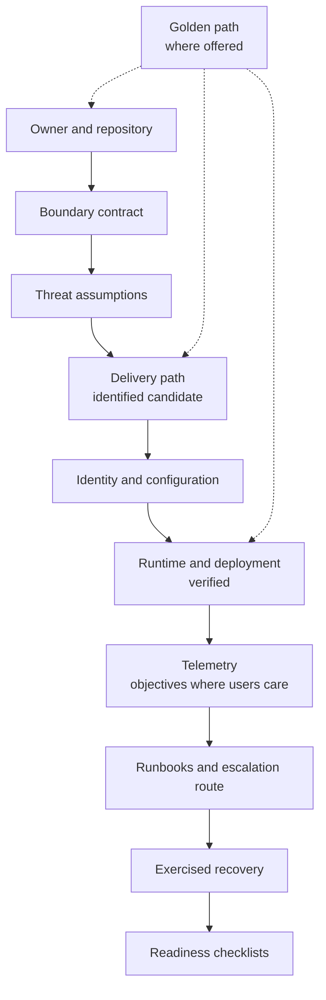

# New Service

This reference answers **what must exist before a new service is operationally real?** It composes existing doctrine; it creates no new requirements.

If this reference conflicts with a canonical principle or owning pattern, the canonical owner wins and this reference is defective.

## Use When

Use this when creating a service or other deployable unit, or when checking what an inherited one still lacks. Each step routes to the reference that owns its shape. "Operationally real" is a label, not a gate: shorthand for the operability described in [Core Proposition 8](../../ENGINEERING.md#8-preserve-operability-and-learn-from-incidents).

## Standard Shape

Where a platform offers a golden path, it is the normal way to get most of this at once.

The order is a reading order, not a rule. Owners fix only a few sequence points, including threat assumptions recorded early, validation before packaging, verification after deployment, a minimum runbook before paging, and recovery defined before it is needed.

## Invariants

These summarise the canonical owners below, including their applicability and exception paths.

1. **Named owner:** each service or deployable unit has a named owner team, with an on-call or escalation path where applicable.
2. **Findable repository:** the README states purpose, setup, and pointers to contracts and pipelines, and ownership is obvious from the repository. Contracts live under an agreed tree.
3. **Contract at each material boundary:** consumer, service, event, and data boundaries are versioned and validated.
4. **Threat assumptions recorded early:** new surfaces get a lightweight STRIDE pass. Trivial internal tools record "not in scope".
5. **Controlled path to a verified deployment:** changes reach a protected branch through review and required checks, builds produce traceable artefact identifiers, and deployment is incomplete until verification proves the service healthy enough for its intended use.
6. **Verified identity:** estate-governed and production workloads, including CI and CD jobs, use short-lived platform or federated identity where the target accepts it.
7. **Diagnosable:** logs, metrics, and traces suffice to debug production incidents without reproducing them locally. User-facing paths have availability and latency objectives.
8. **Runbooks:** runbooks cover deploy, rollback, and common failures, and are walked on a defined cadence.
9. **Recovery before need:** recovery is defined before it is needed. Where the service holds data, recovery objectives are set per data class and restores are tested on a cadence.

## Normal Implementation

| Step | What the engineer does | Continue in |
| --- | --- | --- |
| Own | Name the owner team and escalation route. Write the README and the day-one route. | [Collaboration](../principles/collaboration.md) §8 |
| Bound | Write a versioned contract for each boundary exposed or consumed. | [Service API](service-api.md), [Event Consumer](event-consumer.md) |
| Model threats | Record threat assumptions and track open risks with owners. | [Threat Modeling (STRIDE Lite)](../principles/threat-modeling-stride-lite.md) |
| Deliver | Name the build surfaces, wire the local gate and protected trunk, scan secrets and dependencies, and produce an identified candidate. | [CI/CD Delivery](cicd-delivery.md), [Branching And Integration](branching-and-integration.md), [Testing And Verification](testing-and-verification.md), [Local Checks With Git Hooks](git-hooks.md), [Dependency Adoption](dependency-adoption.md) |
| Identify | Bind workload and pipeline to scoped platform identities; keep secrets out of configuration and source control. | [Secretless Workload Identity](secretless-workload-identity.md), [Privileged Automation](privileged-automation.md) |
| Deploy | Choose the runtime, deploy the candidate, and verify it. | [Application Deployment](application-deployment.md), [Infrastructure Delivery](infrastructure-delivery.md), [Database Migration](database-migration.md) |
| Observe | Instrument the main path with correlated signals. Agree objectives for user-facing paths with product and stakeholders. | [Service Observability](service-observability.md) |
| Operate | Write and walk the runbooks. Record the severity matrix and escalation order. Test a restore where the service holds data. | [Release And Rollback](release-and-rollback.md), [Incident Lifecycle And On-Call Operations](../patterns/incident-lifecycle-and-on-call-operations.md) |
| Review | Check the result against the readiness checklists. | [Build Readiness](../checklists/build-readiness.md), [Platform Readiness](../checklists/platform-readiness.md), [Release Readiness](../checklists/release-readiness.md) |

## Common Variations

### Golden Path Available

Start from the path's template or one-command bootstrap. Leaving the path is legitimate: record the reason, a reviewer, and an expiry or revisit trigger. Where the estate keeps a service catalogue, populate the service's entry.

### New Unit In A Shared Repository

A service added to an existing repository needs explicit ownership boundaries through path rules, and normally has its own delivery surface with path filters that reflect that ownership.

### Small Team

Start with the baseline that makes further change safe, then activate profiles as the system requires. A small team keeps to quality gate, trunk, and contracts on shared boundaries, leaving the heavier platform checklist until something ships to users.

### Public, Critical, Regulated, Or Model-Calling

Public exposure, criticality, and personal or regulated data activate further profiles. Typical additions: a STRIDE pass on flows across trust boundaries, retention per data category, residency as an architecture input, an impact assessment before go-live where processing is high risk, and a registered external control profile where a contract or regulation applies. A service that calls models declares its capability tier and materiality in the AI system inventory.

## Boundaries

- **Not a gate or a checklist:** this page sets no readiness bar. Verification prompts live in the checklists; obligations live in the owners.
- **Whether to build it:** this reference starts after that decision. Significant technical choices are recorded as ADRs or an equivalent.
- **Products:** templates, portals, catalogues, and runtimes are tooling or estate choices.
- **Retirement:** decommissioning a service is out of scope.

## Canonical Doctrine

Layer contract: [Implementation References](README.md).

| Concern | Canonical principle or owning pattern |
| --- | --- |
| Ownership, contracts, recovery, operability, and applicability | [Core Propositions 2, 4, 6, and 8](../../ENGINEERING.md#core-propositions); [Applicability And Profiles](../../ENGINEERING.md#applicability-and-profiles); [Adoption Playbook](../patterns/adoption-playbook.md) §6 |
| Owner team, protected branch, build identifiers, objectives, runbooks, and pipeline privilege | [Collaboration](../principles/collaboration.md) §§2, 7–10 |
| README, decision records, runbook cadence, layout, and day-one route | [Documentation And Organisational Knowledge](../principles/documentation-knowledge.md) §§1–3; [Naming And Repository Layout](../principles/naming-and-repo-layout.md) §§1, 3; [Developer Experience](../principles/developer-experience.md) §§1, 3 |
| Threat assumptions | [Secure Development Lifecycle](../principles/secure-development-lifecycle.md) §1; [Threat Modeling (STRIDE Lite)](../principles/threat-modeling-stride-lite.md) §§1–2 |
| Build surfaces, local gate, deployable units, verification, scanning, and runtime choice | [Build Principles](../principles/build.md) §§1, 3–5, 10; [Container Runtime Choice](../principles/container-runtime-choice.md) §§1–2 |
| Workload identity, configuration, and secrets | [Zero Trust And Workload Identity](../principles/zero-trust-and-workload-identity.md) §2; [Configuration And Secrets](../principles/configuration-and-secrets.md) §§1, 4 |
| Telemetry, objectives, severity, escalation, and restore testing | [Observability](../principles/observability.md) §2; [Reliability](../principles/reliability-slo-incidents.md) §1; [Incident Lifecycle And On-Call Operations](../patterns/incident-lifecycle-and-on-call-operations.md) §§2, 6; [Data And Migrations](../principles/data-and-migrations.md) §2 |
| Golden paths, service catalogue, and recorded exceptions | [Platform As Product And Golden Paths](../patterns/platform-as-product-and-golden-paths.md) §§2, 4, 6–7; [Platform Engineering](../principles/platform-engineering.md) §5 |
| Data and AI profiles | [Privacy And Data Governance](../principles/privacy-and-data-governance.md) §§2–3, 5.1, 6; [AI And ML-Assisted Systems](../principles/ai-ml-systems.md) §2; [AI Adoption Controls](../patterns/ai-adoption-controls.md) §1 |

Tooling and verification: [Build Readiness](../checklists/build-readiness.md), [Platform Readiness](../checklists/platform-readiness.md), [Release Readiness](../checklists/release-readiness.md), and [CI Platform Mapping](../tooling/ci-platform-mapping.md).

Related references: each step above names its reference.

Decisions and evidence: [ADR 0048](../../docs/adr/0048-add-implementation-reference-layer.md) and the [batch 3 owner audit](../evolution/research-impl-backlog-batch-3-composition-2026-11.md).
