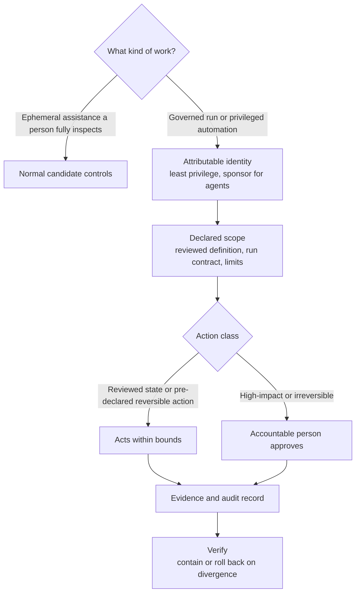

# Privileged Automation

This reference answers **what rules apply when automation can mutate real systems?** It composes existing doctrine; it creates no new requirements.

If this reference conflicts with a canonical principle or owning pattern, the canonical owner wins and this reference is defective.

## Use When

Use this when a pipeline, scheduled job, reconciler, bot, or AI agent can change production or estate-governed systems, or to decide whether model-driven work has moved from assistance to governed execution. Siblings cover credentials ([Secretless Workload Identity](secretless-workload-identity.md)), promotion ([CI/CD Delivery](cicd-delivery.md)), exposure and recovery ([Release And Rollback](release-and-rollback.md)), parallel coding agents ([Parallel Work In Git Worktrees](git-worktrees.md)), and skill and tool-server admission ([Dependency Adoption](dependency-adoption.md)).

## Standard Shape

The owners draw three lines that do not coincide: an interactive assistant running tools is a governed run under its developer's identity.

| Question | Owner's line | Activates |
| --- | --- | --- |
| Is the run governed? | A model interaction invokes tools, mutates persistent or external state, runs asynchronously, delegates, or meets another listed trigger | Run contract |
| Is the agent its own principal? | It holds its own credentials, standing infrastructure, or unattended operation; a tool acting entirely under a person's interactive session is that person's session | Agent identity duties |
| Is the definition privileged? | Its automation can read secrets, mutate production, publish packages, or alter downstream systems; agent definitions count on the merge path or with standing credentials beyond the invoking person's session | Pipeline-definition trust class |

## Invariants

These summarise the canonical owners below, including their applicability and exception paths.

1. **Assistance is not authority:** agents propose; they do not silently change production or protected branches outside the gates human contributors face. A model output, self-score, multi-model vote, or agent-authored approval is not merge or deployment authority.
2. **Privileged definitions are code:** a pipeline definition that can read secrets, mutate production, publish packages, or alter downstream systems is reviewed and analysed in the same trust class as application code. In-scope agent definitions add no self-review and an informed reviewer.
3. **Gates bind:** a claimed merge requirement is enforced by platform configuration; a step that always succeeds is telemetry. A pipeline change that weakens or bypasses gates is merge-blocking unless a time-bounded exception is recorded.
4. **Scoped identity:** pipeline identities are scoped to what each pipeline needs, and production deploy is not the default permission for every job.
5. **Agent principals are tiered:** among agents holding their own workload identity, high-autonomy or material agents (Tier D, write access to production, or unattended operation at material blast radius) act under a dedicated per-agent principal, tagged as an agent and resolvable to its sponsor. Lower-autonomy agents (assistive, read-mostly, team pipeline context) can share a team principal, provided the runner stamps a per-agent identifier on every action and the estate records that revocation is fleet-wide.
6. **Sponsored and revocable:** every agent identity has a named human sponsor, a role whose current holder is a named person; an orphaned agent is disabled. Revocation is the kill switch: per agent on a dedicated principal, fleet-wide on a shared one. Credentials are normally scoped per interaction or task.
7. **Declared scope, enforced outside the model:** every governed execution has a run contract. The executor enforces declared authority independently of the model, which cannot rewrite its contract mid-run. Stop and budget ceilings sit outside the context window, and delegation cannot widen authority.
8. **Human approval follows the action:** where AI participates in delivery, high-impact change needs accountable human approval, including authentication, authorisation, cryptography, data or schema migration, pipeline or policy change, and irreversible operations. Agent autonomy starts conservative and narrows on any regression or incident. Auth, tenancy, crypto, schema, money-movement, and person-affecting actions start at approve-before-irreversible whatever the agent's maturity.
9. **Bounded automatic action:** automation can roll a deployment back to the previously verified candidate when the trigger, target, and alert are recorded and the path exercised; it does not widen exposure or roll forward. An operational agent cannot detect, implement, approve, and deploy its own change as one closed authority loop.
10. **Evidence accompanies authority:** where automation holds write or deploy authority, retained evidence answers which revision, workflow identity, artefacts, human approvals if any, and policy version applied. Privileged actions leave audit records of actor, operation, resource, time, and outcome, without secret values. They preserve the full delegation chain when an agent acts on someone's behalf.

## Normal Implementation

| Step | What the engineer does |
| --- | --- |
| Classify | Answer the three questions; record AI systems in the inventory with capability tier, materiality, owner, and oversight mode. |
| Bind identity | Scope the identity; for an agent, choose the principal by tier and record the sponsor. |
| Declare scope | For a governed run, write the contract: closed tool set, deny-by-default authority, required outputs, and verifier packs. |
| Bound | Enforce stop and budget ceilings in the host. Set the autonomy position from blast radius and verifiability. |
| Run and verify | The executor checks declared tools, policies, and packs first; a missing required dependency fails closed. Verification binds outside the model's own report. |

## Common Variations

### Pipelines, Scheduled Jobs, And Reconcilers

Scheduled scans, queued automation, and recurring runbooks are delivery surfaces in their own right, with explicit entrypoints, permissions, contracts, and evidence outputs. Reconcilers apply desired state reviewed through the version-control path or a governed import with an audit trail; every material apply is tied to a known revision, and drift is measured and triaged.

### Update Bots

Update classes the estate defines as low risk can merge on a documented bot-only path once required checks pass; other updates get human review.

### Standing Agent Runs

A standing trigger comes last, after a supervised manual run, a versioned template, and hardened enforcement, and it does not widen autonomy.

### Agent Responders

This applies only where agents are rostered into incident response. A named accountable human owner can stop the agent at any time. Pre-declared, tested, deterministic reversible actions can run under a scoped response plan; irreversible or production-mutating actions, including any novel mutation, wait for human approval.

## Boundaries

- **Model-driven scope:** run contracts are defined for model interactions; deterministic automation relies on its reviewed definition and explicit execution surface.
- **Stop controls:** owners state revocation, outside-the-model ceilings, and propagated cancellation for agents, and a named person who can stop an agent responder. No owner states a general stop authority for standing agents or for other automation. Product kill switches belong to [Release And Rollback](release-and-rollback.md) and [configuration doctrine](../principles/configuration-and-secrets.md).
- **Person-affected decisions:** runtime fallback, authority to override or halt, and contest paths belong to AI adoption controls.
- **Exceptions and emergencies:** departures go through the [exception contract](../patterns/normative-language-applicability-and-exceptions.md#5-exception-contract); documented emergency changes still get a retrospective.

## Canonical Doctrine

Layer contract: [Implementation References](README.md).

| Concern | Canonical principle or owning pattern |
| --- | --- |
| Binding gates, privileged definitions, evidence for automation authority | [Merge Path Evidence And Pipeline Integrity](../principles/merge-path-evidence-and-pipeline-integrity.md) §§1–2 |
| Agent principal tiers, sponsor, credentials, revocation, attribution | [Zero Trust And Workload Identity](../principles/zero-trust-and-workload-identity.md#21-agent-identity) §§2, 2.1 |
| Governed-execution triggers, envelope, executor duties | [Run Contracts](../patterns/run-contracts.md#11-when-a-run-is-governed) §§1.1, 3, 6, 8, 9 |
| Autonomy slider, build order, outside-the-model limits, delegation | [Agentic Loop Design](../patterns/agentic-loop-design.md) §§6, 6.1, 8.3 |
| Agents propose; governed execution | [AI And ML-Assisted Systems](../principles/ai-ml-systems.md) §§2, 4; [Core Proposition 10](../../ENGINEERING.md#10-govern-ai-assisted-change-without-creating-a-second-delivery-path) |
| Human-gated high-impact change; closed-loop rule | [AI-Native Software Development Lifecycle](../patterns/ai-native-software-development-lifecycle.md) §§3, 13 |
| AI inventory, oversight mode, runtime human fallback | [AI Adoption Controls](../patterns/ai-adoption-controls.md) §§1–2 |
| Audit event selection, fields, secret exclusion | [Audit Logging](../principles/audit-logging.md) §§1–3 |
| Gate-weakening changes as merge blockers | [Code Review And Change Approval](../patterns/code-review-and-change-approval.md) §3 |
| Bot-only and emergency paths, pipeline least privilege, automated rollback | [Collaboration](../principles/collaboration.md) §§2, 8, 8.1, 9; [Dependencies And Supply Chain](../principles/dependencies-supply-chain.md) §2 |
| Execution surfaces; reviewed desired state and drift | [Build Principles](../principles/build.md) §8; [GitOps And Declarative Operations](../patterns/gitops-and-declarative-operations.md) §4 |
| Agent responders | [Incident Lifecycle And On-Call Operations](../patterns/incident-lifecycle-and-on-call-operations.md) §10 |

Tooling and verification: [Merge Path And Pipeline Control Suite](../tooling/merge-path-and-pipeline-control-suite.md), [AI Adoption Readiness](../checklists/ai-adoption-readiness.md), and [AI-Native SDLC Readiness](../checklists/ai-native-sdlc-readiness.md).

Related references: [Secretless Workload Identity](secretless-workload-identity.md), [CI/CD Delivery](cicd-delivery.md), [Release And Rollback](release-and-rollback.md), [Parallel Work In Git Worktrees](git-worktrees.md), and [Dependency Adoption](dependency-adoption.md).

Decisions and evidence: [ADR 0048](../../docs/adr/0048-add-implementation-reference-layer.md) and the [batch 3 owner audit](../evolution/research-impl-backlog-batch-3-composition-2026-11.md).
