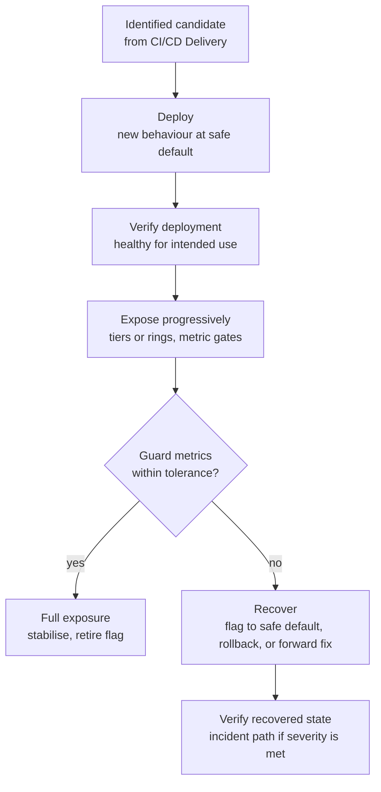

# Release And Rollback

This reference answers **how are releases exposed, verified, and recovered?** It composes existing doctrine; it creates no new requirements.

If this reference conflicts with a canonical principle or owning pattern, the canonical owner wins and this reference is defective.

## Use When

Use this once an identified candidate exists: how users meet it, how you know it is healthy in production, and how you back out. How code becomes that candidate is [CI/CD Delivery](cicd-delivery.md). Urgent patches against a tagged release follow [Branching And Integration](branching-and-integration.md); schema and persisted-data change follows [Database Migration](database-migration.md).

## Standard Shape

Where a flag carries the change, deploying and releasing are separate moves: the candidate runs in production while the new behaviour stays at its safe default. Exposure, verification, and recovery are sized to blast radius, so a small internal change can collapse several boxes.

Recovery depends on what changed: behaviour behind a flag reverts by targeting, a bad candidate rolls back or is fixed forward, and schema or data recover through a new forward migration or an application rollback.

## Invariants

These summarise the canonical owners below, including their applicability and exception paths.

1. **Known candidate:** what is running is identified by the deployed candidate, its source revision, configuration binding, and deployment evidence, not by the tip of trunk.
2. **Proportionate rollout and recovery:** rollout, containment, rollback or forward recovery, and runtime observation are proportionate to blast radius. Risky changes use canaries, gradual rollout, or maintenance windows per service policy.
3. **Deploy separate from activation:** incomplete features ship behind flags whose defaults preserve current behaviour until intentionally enabled. Every flag is typed at creation and has an owner and a stated safe default; release and experiment flags also carry an expiry date.
4. **Metric-gated exposure:** for a flag-controlled rollout, the flag owner records primary and guard metrics before the first tier. Promotion does not proceed while a guard metric degrades beyond its recorded tolerance; calendar-only promotion is not conformant.
5. **Verification closes deployment:** deployment is incomplete until verification proves the deployed thing is healthy enough for its intended use, and verification output is kept as durable evidence.
6. **Recovery designed before need:** runbooks cover deploy and rollback and are exercised on a defined cadence. A missing rollback story for a high-risk deploy is a merge-blocking review finding.
7. **Automation only reverts:** flag state transitions are made or authorised by a human and recorded with actor and reason. Automation can trip an ops flag to its safe default when the trip condition, safe default, and alert are recorded on the flag and tested before general availability; for release and experiment flags this is context-dependent, under the same conditions.
8. **Honest stateful recovery:** schema and data roll back through a new forward migration or an application rollback. Take a snapshot or enable point-in-time recovery before high-risk migrations where the platform supports it. Once a flag's removal change has merged, recovery is a deployment rollback, not a flag transition.
9. **Error budget shapes release policy:** where a service has SLOs, its error budget policy states what happens when budget is exhausted or nearly so, such as freezing risky deploys, with exceptions documented for security or severe customer impact.
10. **Failure feeds learning:** a failed release that crosses the severity threshold runs as an incident. Material incidents get a blameless review with owned, tracked actions, and emergency changes still get a retrospective.

## Normal Implementation

| Step | What the engineer does |
| --- | --- |
| Prepare | Take the candidate identity from the delivery path. Update version, release notes, and any migration notes in tracked release metadata, recording API and artefact versions separately when they diverge. Confirm the rollback runbook and complete any flag metadata. |
| Deploy | Deploy with new behaviour at its safe default where a flag carries it. Schema or data changes follow [Database Migration](database-migration.md). |
| Verify | Run post-deploy smoke or synthetic checks and watch SLIs, where defined, and symptom-based alerts; retain the result with the candidate. Evidence placement: [Testing And Verification](testing-and-verification.md). |
| Expose | Move through tiers or rings, holding each for at least one monitoring window, and record metric values per tier. |
| Recover | Revert the flag to its safe default or a lower tier with a recorded reason, roll back to a previous candidate, or ship a forward fix through the controlled path or a documented emergency path. Verify the recovered state like any deployment. |
| Stabilise and retire | At full exposure, hold guard metrics for a monitoring window, then remove the flag code and its variation tests in one change. |

## Common Variations

### Whole-Candidate Rollout Without A Flag

Exposure is the deployment itself: service policy chooses a canary, gradual rollout, or maintenance window, and recovery is a deployment rollback or forward fix. Before the rollout starts, record the signals the canary is judged on and their tolerance, and do not widen exposure while one degrades beyond it. Automation can roll back to the previously verified candidate when the trigger, target, and alert are recorded and the path has been exercised; it does not roll forward.

### Declarative Operations

Rollback is a revert of desired state through the version-control path, tied to a known revision and applied by a reconciler or governed push; the decider can merge it under the documented emergency path, with review afterwards. Break-glass is rare and followed by a return to declared state; frequent break-glass signals a governance or automation gap.

### Published Packages And Clients

Consumers pin and upgrade these units independently. Pre-release labels signal risk before a stable tag; where several channels exist, document who consumes each, promotion between them, and whether production can pin a pre-release. A regression repair ships as a patch; removing a public surface follows documented deprecation and lands in a major or an intentional pre-1.0 breaking wave.

### Regulated Or Person-Affected Profiles

Regulated-data profiles audit-log every targeting change and state transition with actor, time, and reason. Person-affected profiles add the harm-surface evaluation to metric gates and a 24-hour minimum dwell per tier.

## Boundaries

- **Delivery path:** building, publishing, and promoting the candidate belong to [CI/CD Delivery](cicd-delivery.md).
- **Persisted state:** a flag can switch which shape code uses, but the data recovers through [Database Migration](database-migration.md) and its owners.
- **Effects beyond the deployable:** sent messages, external calls, and committed workflow steps recover through compensation and reconciliation designed before need.
- **Who decides:** flag reversal is decided by the flag owner or an incident commander. Rollback to the previously verified candidate can be done by the service owner, the on-call engineer following the runbook, or the incident commander. Where desired state is declared in version control, that rollback is a revert through the same path, merged under the documented emergency path and reviewed afterwards. Estates with agent responders route remediation by reversibility under the incident pattern.
- **Numbers and products:** tiers, dwell times, tolerances, lifetimes, and budget policy stay in their owners; flag stores, rollout controllers, and reconcilers are tooling.

## Canonical Doctrine

Layer contract: [Implementation References](README.md).

| Concern | Canonical principle or owning pattern |
| --- | --- |
| Deployed-candidate identity, flag defaults, canaries and their signals, rollback decider, runbooks, and emergency retrospectives | [Collaboration, Trunk-Based Delivery, And Operational Rigour](../principles/collaboration.md) §§1, 4, 8, 8.1 |
| Proportionate recovery; compensation designed before need | [Core Proposition 3](../../ENGINEERING.md#3-keep-changes-reviewable-reversible-and-observable), [Core Proposition 6](../../ENGINEERING.md#6-design-failure-retry-recovery-and-reconciliation) |
| Flag types, metadata, lifecycle, reversal, metric gates, automated reversion, and profiles | [Feature Flag Governance](../patterns/feature-flag-governance.md) §§1–7 |
| Post-deploy verification, release metadata, and retrievable evidence | [Build Principles](../principles/build.md) §§5–7, 12 |
| Runtime verification responsibilities and the hotfix path | [Trunk Workflow And Delivery Surfaces](../patterns/trunk-workflow.md) |
| Patch, major, pre-release channels, release notes, and deprecation | [Semantic Versioning Policy](../principles/semantic-versioning.md) §§2, 4, 5, 6.3, 8, 9 |
| SLIs and symptom-based alerting | [Observability](../principles/observability.md) §§4–5 |
| Error budget policy and incident response | [Reliability: SLOs, Error Budgets, And Incidents](../principles/reliability-slo-incidents.md) §§2–3 |
| Severity, incident command, post-incident actions, and agent responders | [Incident Lifecycle And On-Call Operations](../patterns/incident-lifecycle-and-on-call-operations.md) §§1–3, 9, 10 |
| Rollback story for high-risk deploys | [Code Review And Change Approval](../patterns/code-review-and-change-approval.md) §3 |
| Runbooks and their exercise cadence | [Documentation And Organisational Knowledge](../principles/documentation-knowledge.md) §2 |
| Forward-only data recovery and pre-migration safety nets | [Data, Migrations, Backups, And Recovery](../principles/data-and-migrations.md) §§1, 3 |
| Declarative rollback and break-glass | [GitOps And Declarative Operations](../patterns/gitops-and-declarative-operations.md) §§3–4 |

Tooling and verification: [Release Readiness Checklist](../checklists/release-readiness.md), [Platform, SRE, And Extended Readiness Checklist](../checklists/platform-readiness.md), and [Observability Tooling](../tooling/observability.md).

Related references: [CI/CD Delivery](cicd-delivery.md), [Testing And Verification](testing-and-verification.md), [Branching And Integration](branching-and-integration.md), [Database Migration](database-migration.md), and [Service Observability](service-observability.md).

Decisions and evidence: [ADR 0048](../../docs/adr/0048-add-implementation-reference-layer.md) and the [composition research note](../evolution/research-impl-backlog-batch-2-composition-2026-11.md).
