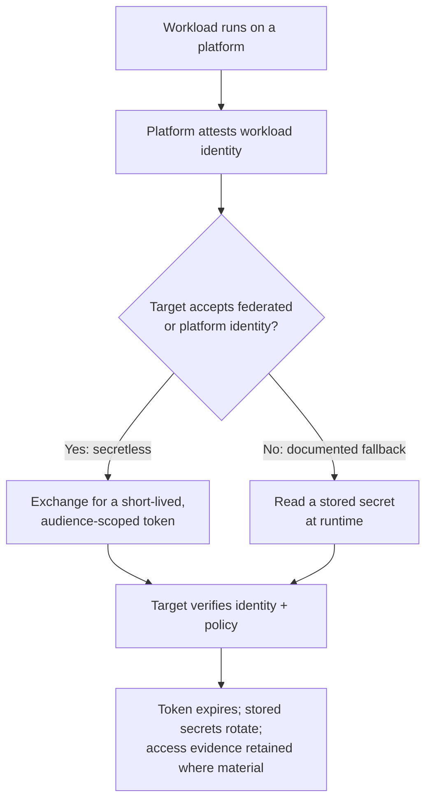

# Secretless Workload Identity

This reference answers **how does an application, job, or pipeline get the access it needs without holding a stored secret?** It composes existing doctrine; it creates no new requirements.

If this reference conflicts with a canonical principle or owning pattern, the canonical owner wins and this reference is defective.

## Use When

Use this when a service, scheduled job, CI pipeline, or deployment needs to call a cloud API, database, internal service, or third-party API. It also covers the fallback for targets that still require a stored secret. For how the receiving service authenticates and authorises that call, continue to [Service API](service-api.md).

## Standard Shape

**Secretless** means the team stores, distributes, and rotates no long-lived credential for this access. The platform issues short-lived credentials bound to the workload's identity and replaces them automatically. Tokens still exist; nobody keeps them as secrets.

For estate-governed and production workloads, including CI and CD jobs, the owning principle makes this path the default wherever the target supports it. A stored secret for a target that cannot federate is a registered fallback with an owner, a rotation path, a blast-radius statement, and the reason federation is unavailable.

## Invariants

These summarise the canonical owners below, including their applicability and exception paths.

1. **Identity, not location:** network placement does not authorise a sensitive action. Service-to-service calls use authenticated identities rather than shared static service passwords, unless a documented exception exists.
2. **Secretless by default:** estate-governed and production workloads, including CI and CD jobs, use short-lived, audience-scoped credentials from platform or federated identity wherever the target accepts it. A stored secret for such a target needs a bounded exception.
3. **No ambient credentials:** a credential is not readable by every process on a host, and tokens are scoped to their purpose.
4. **Configuration is not a secret:** endpoints and pool sizes are configuration; passwords, keys, and client secrets come from a secret store, managed identity, or short-lived token.
5. **Nothing committed:** real secrets never enter source control. An example file lists names and shape only. Secret scanning runs before merge.
6. **Pipelines federate:** CI receives cloud access through OIDC federation where the target supports it; otherwise through ephemeral scoped credentials or a registered fallback. Pipeline definitions that can read secrets or deploy are reviewed in the same trust class as application code, and their use of authority leaves evidence.
7. **Fallbacks are registered and rotated:** a fallback secret records its owner, rotation cadence, blast radius, and why federation is unavailable, with rotation triggers after personnel or incident changes. Rotation is automated where the platform supports it, and signing keys are versioned so verifiers can overlap during cutover.
8. **Secret values stay out of evidence:** logs and audit records carry references or hashes, never secret values. Privileged and security-sensitive access produces audit evidence where material.
9. **Humans use the human path:** operator access uses MFA and just-in-time elevation where supported. Break-glass accounts are rare, monitored, and reviewed.

## Normal Implementation

| Step | What the engineer does |
| --- | --- |
| Inventory | List each target the workload calls: purpose, permissions, and whether it accepts federated or platform identity. That last answer decides the path. |
| Bind | Bind the workload to a platform identity whose permissions match its own purpose. |
| Federate | Exchange the platform identity for a short-lived token scoped to the target and the minimum permissions. This is the default path. |
| Wire CI | Federate the pipeline identity to the cloud or registry it deploys to. Avoid long-lived organisation-wide tokens, especially where untrusted forks can run workflows. |
| Fall back | For a target that cannot accept federated identity, store the secret in the estate's secret store, inject it at runtime rather than baking it into an image, and register its owner, rotation cadence, blast radius, and the reason federation is unavailable. A federatable target that cannot move yet gets a bounded exception instead. |
| Develop locally | Commit an example file with names and shape only. Real values stay outside source control. |
| Verify | Run secret scanning in the build, and test that calls without the expected identity or scope are denied. |
| Operate | Rotate fallback secrets on schedule and after personnel or incident events. For automation with write or deploy authority, keep enough evidence to answer which revision, workflow identity, artefacts, approvals, and policy version applied. |
| Revisit | When a target or platform adds federated identity, the default applies: move that access to the secretless path and retire the stored secret. |

## Common Variations

### Container Orchestration Platforms

Service-account federation keeps cloud access secretless. For unavoidable static secrets, use an external secret operator or CSI driver, and enable encryption at rest for platform secret storage according to the provider baseline. Avoid baking secrets into images or unencrypted backups.

### Managed Runtime Or Serverless

Platform managed identity usually provides the secretless path directly. The invariants are unchanged: a scoped identity, minimum permissions, and a store for any remaining static secret.

### Cross-Platform Or On-Premises Workloads

A vendor-neutral workload identity shape such as SPIFFE can provide verified, short-lived identity where no single cloud identity spans the estate. Mesh-issued mutual TLS is one implementation, not a requirement.

### Databases

Where the platform supports it, managed identity or dynamic database credentials keep database access secretless and rotation automatic. Otherwise the database password is a fallback secret with an owner and a rotation path.

### Third-Party API Keys And Webhook Secrets

Most third-party APIs and webhook senders still require a static key or signing secret. Store it, scope it as narrowly as the provider allows, rotate it, and support an overlapping verification window when a webhook signing secret changes.

### AI Agents Holding Their Own Identity

An agent with its own credentials, standing infrastructure, or unattended operation is a workload with additional identity duties: principal granularity tiered by capability and materiality, a named sponsor, per-task credential scope, and delegation attribution. A tool acting entirely inside a human's interactive session follows the human path instead.

### External Control Profiles

Where a contract, regulation, or estate decision activates an external baseline, that profile binds parameters such as approved mechanisms, rotation periods, and evidence. It does not become a universal default for other systems.

## Boundaries

- **A default, not a ban:** the owning principle makes secretless the default where the target supports it ([ADR 0051](../../docs/adr/0051-make-secretless-workload-identity-the-default.md)). Stored secrets stay valid for targets that cannot federate; they are registered fallbacks, not exceptions. Local development and human access follow their own paths.
- **Products:** secret stores, identity providers, meshes, and CI hosts are tooling choices. This reference names capabilities, not vendors.
- **Authorisation semantics:** what the caller may do once authenticated is owned by the API boundary doctrine and the receiving service's policy.
- **Cryptography:** algorithms, key sizes, and key lifecycle parameters follow the maintained profile in the owning principle.
- **Dynamic configuration:** kill switches and remote configuration need an authenticated, audited control plane and safe defaults. They are configuration, not secrets.
- **Exceptions:** a shared static service password, or a shared principal where the owner requires a dedicated one, goes through the existing exception contract. Permanent deviations route to policy or profile revision rather than renewed exceptions.

## Canonical Doctrine

Layer contract: [Implementation References](README.md).

| Concern | Canonical principle or owning pattern |
| --- | --- |
| No implicit trust from location, secretless default and registered fallback, short-lived scoped workload identity, human and break-glass access | [Zero Trust And Workload Identity](../principles/zero-trust-and-workload-identity.md) §§1–3 |
| Agent principals, sponsors, per-task scope, and delegation attribution | [Zero Trust And Workload Identity](../principles/zero-trust-and-workload-identity.md#21-agent-identity) §2.1 |
| Config versus secrets, managed identity and automated rotation, local and CI handling | [Configuration And Secrets](../principles/configuration-and-secrets.md) |
| Privileged pipeline definitions and evidence for automation authority | [Merge Path Evidence And Pipeline Integrity](../principles/merge-path-evidence-and-pipeline-integrity.md) |
| Secret scanning in the build model | [Build Principles](../principles/build.md) §10 |
| Secrets on container orchestration platforms | [Kubernetes Platform Security](../principles/kubernetes-platform-security.md) |
| Service-to-service mutual TLS and boundary cryptography | [API Boundaries, HTTP Semantics, And API Security](../principles/api-boundaries-and-security.md) §§2.1, 7 |
| Signing-secret rotation windows for inbound callbacks | [Webhook Ingress Security](../patterns/webhook-ingress-security.md) |
| Audit evidence and exclusion of secret values | [Audit Logging](../principles/audit-logging.md) |
| Protect practices in the secure development lifecycle | [Secure Development Lifecycle And Vulnerability Response](../principles/secure-development-lifecycle.md) |
| Negative-security tests for denied identity and scope | [Testing Strategy](../principles/testing-strategy.md) §5 |
| Revision-pinned external baselines | [Revision-Pinned External Control Profiles](../patterns/revision-pinned-control-profiles.md) |
| Exception authority and permanent-deviation routing | [Normative Language, Applicability, And Exceptions](../patterns/normative-language-applicability-and-exceptions.md#5-exception-contract) |

Tooling and verification: [Merge Path And Pipeline Control Suite](../tooling/merge-path-and-pipeline-control-suite.md), [CI Platform Mapping](../tooling/ci-platform-mapping.md), [Build Readiness](../checklists/build-readiness.md), and [AI Adoption Readiness](../checklists/ai-adoption-readiness.md) for agents holding workload identity.

Related references: [Service API](service-api.md) and [CI/CD Delivery](cicd-delivery.md).

Decisions and evidence: [ADR 0048](../../docs/adr/0048-add-implementation-reference-layer.md) and the [composition research note](../evolution/research-impl-reference-batch-composition-2026-11.md).
