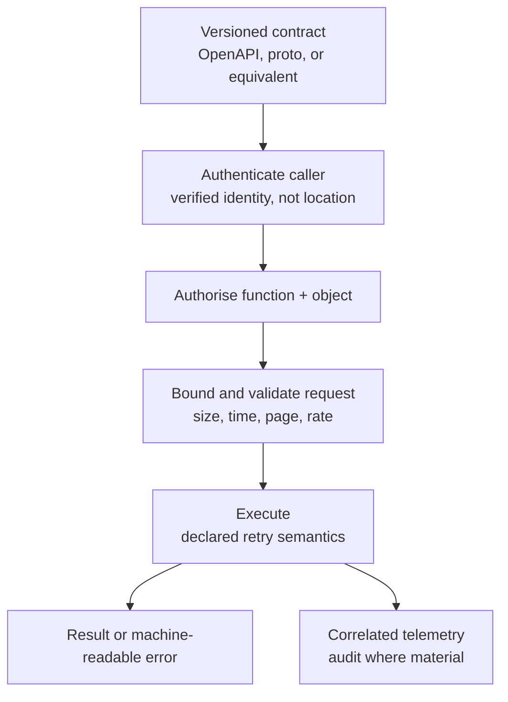

# Service API

This reference answers **how should one service expose functionality to another service or client?** It composes existing doctrine; it creates no new requirements.

If this reference conflicts with a canonical principle or owning pattern, the canonical owner wins and this reference is defective.

## Use When

Use this when adding, changing, or retiring a synchronous HTTP or RPC endpoint that another service, client, or integration calls. For asynchronous messages, start from [Event And Message Contracts](../principles/event-contracts.md). For callbacks you receive from third parties, add [Webhook Ingress Security](../patterns/webhook-ingress-security.md).

## Standard Shape

The contract is what consumers depend on. Identity, authorisation, limits, retry semantics, errors, and telemetry are properties of every route, not features of a gateway alone.

## Invariants

These summarise the canonical owners below, including their applicability and exception paths.

1. **Contract first:** the API has one versioned contract that is validated in the build and serves as the live inventory of its routes.
2. **Verified caller:** every protected route authenticates the caller. Service-to-service calls use cryptographic or platform workload identity rather than network placement or a shared static password, unless a documented exception exists.
3. **Authorisation at object and function level:** check each identifier against the caller's scope and each route and method against the caller's role or claims. Writable fields come from an allowlist.
4. **Bounded requests:** body size, timeouts, page size, and per-identity rate limits are set. Authentication and sensitive business flows get stricter limits.
5. **Declared retry semantics:** document which operations are safe to retry. Mutations that clients may retry declare a duplicate-handling strategy, enforced at the controlling boundary where a duplicate could cause material harm.
6. **Machine-readable errors:** failures use stable problem types with actionable client messages; operator detail goes to logs, not responses.
7. **Correlated telemetry:** trace context propagates across the call; logs carry trace and span identifiers; metric labels stay low-cardinality.
8. **Audit where material:** privileged, security-sensitive, policy-relevant, financially material, or externally consequential actions produce audit evidence with actor, action, resource, time, outcome, and correlation, plus the delegation chain where one principal acts for another.
9. **Untrusted outbound calls:** when the service calls another API, it applies timeouts, failure isolation, and response validation, and treats user-supplied URLs as an SSRF surface.

## Normal Implementation

| Step | What the engineer does |
| --- | --- |
| Design | Write or extend the contract before the handler. Classify the change as additive or breaking, and use the API product's one primary versioning mechanism. |
| Identify | Bind the calling workload or user to a verified identity through the platform's identity mechanism. Follow [Secretless Workload Identity](secretless-workload-identity.md) for how the caller obtains its credential. |
| Authorise | Enforce function-level and object-level checks in the service. Gateway authentication alone does not satisfy object-level authorisation. |
| Bound | Set request size, timeout, pagination, and rate limits per client identity. Reject unbounded list endpoints. |
| Retry | For each mutating operation, record whether it is naturally idempotent, uses an idempotency key, relies on a conditional transition, or keeps a durable first outcome. Persist key-to-outcome mappings for the documented retry window where keys are used. |
| Fail | Return stable, machine-readable errors. Keep stack traces out of production responses unless a documented debug mode applies. |
| Observe | Propagate trace context, emit structured logs joined to traces, and define SLIs where the service has SLOs. Emit audit records for in-scope actions. |
| Verify | Run contract or schema checks in CI, plus negative tests for authentication, authorisation, and limits. Changes touching authentication, authorisation, or new internet-exposed surface follow the security review class and any binding adversarial gate that policy requires. |
| Evolve | Make additive changes first. A breaking change gets a new version, a documented migration, a deprecation notice, and usage evidence before removal. |

Release notes record both the API version and the artefact version when they diverge.

## Common Variations

### Internal East-West API

Mutual TLS or platform workload identity usually carries caller identity. A private API can use a shorter deprecation notice when its private boundary is documented. Network placement still does not replace authorisation.

### Public Or Partner API

Public APIs typically use TLS with OAuth or OIDC. Publish the contract for every supported major version, apply longer deprecation windows for unknown integrators, and keep undocumented administrative routes off the public host. Browser-facing APIs add explicit CORS origins, cookie attributes, and an appropriate content security policy.

### gRPC And Protobuf

The `.proto` files and package conventions are the contract. Generate stubs in CI with pinned tooling. Where browsers or third parties cannot speak gRPC, document the gateway or transcoding boundary.

### GraphQL

Treat query planning as part of the security and capacity boundary: depth and cost limits, paginated list fields, deliberate batching, request timeouts, a production introspection policy, and authorisation in every resolver. The owning principle holds the starting numeric ranges.

### High-Cost Or Irreversible Mutations

Payments, provisioning, allocations, and external actions need an enforced duplicate-detection strategy and an audit record. Expect stricter rate limits or step-up controls on these flows.

### Agent Tool Servers

A tool server exposed to AI agents is still an HTTP or RPC boundary under this reference. Protocol-revision pinning, remote-server authorisation, and registry posture are owned by the AI and ML-assisted systems principle.

## Boundaries

- **Style guides:** resource naming, pagination style, and field casing are team or API-product conventions. This reference does not choose them.
- **Gateways and meshes:** these are optional enforcement points. The invariants hold whether limits and identity checks run in a gateway, a sidecar, or the service.
- **Asynchronous integration:** queues, topics, buses, and webhooks are message-shaped boundaries with their own envelope, payload, delivery, and idempotency doctrine. Choosing between a call and an event is a design decision this reference does not make.
- **Numeric defaults:** limits, depth ranges, deprecation windows, and retry windows remain in their owners and are tuned per product.
- **Cryptography:** algorithm and key-lifecycle choices follow the maintained profile in the owning principle, not this reference.

## Canonical Doctrine

Layer contract: [Implementation References](README.md).

| Concern | Canonical principle or owning pattern |
| --- | --- |
| Versioned, validated boundary contracts | [Core Proposition 4](../../ENGINEERING.md#4-define-and-verify-material-boundaries) |
| Authentication, object and function authorisation, limits, browser controls, SSRF, inventory, and outbound consumption | [API Boundaries, HTTP Semantics, And API Security](../principles/api-boundaries-and-security.md) |
| Machine-readable errors and retry documentation | [Errors And Failure Modes](../principles/errors-and-failure-modes.md) |
| Timeouts, bounded retries, and overload behaviour | [Errors And Failure Modes](../principles/errors-and-failure-modes.md) §4 |
| Duplicate handling for retried mutations | [Idempotency Across Boundaries](../patterns/idempotency-across-boundaries.md) |
| Verified service identity and least privilege | [Zero Trust And Workload Identity](../principles/zero-trust-and-workload-identity.md) |
| API versioning, deprecation, and sunset | [Semantic Versioning Policy](../principles/semantic-versioning.md) §§6–9 |
| Contract tests and risk-based depth | [Testing Strategy](../principles/testing-strategy.md) |
| gRPC, Protobuf, and interoperable contract shapes | [Interoperability, Standards, And Vendor Reality](../principles/interoperability-and-standards.md) |
| Trace propagation, correlation, and cardinality | [Observability](../principles/observability.md) |
| SLOs for user-visible journeys | [Reliability: SLOs, Error Budgets, And Incidents](../principles/reliability-slo-incidents.md) |
| Audit evidence selection and fields | [Audit Logging](../principles/audit-logging.md) |
| Security and public-contract review classes | [Code Review And Change Approval](../patterns/code-review-and-change-approval.md) §5 |
| Binding adversarial gates where policy requires them | [Merge Path Evidence And Pipeline Integrity](../principles/merge-path-evidence-and-pipeline-integrity.md) |
| Inbound third-party callbacks | [Webhook Ingress Security](../patterns/webhook-ingress-security.md) |
| Agent tool-server protocol baseline | [AI And ML-Assisted Systems](../principles/ai-ml-systems.md) §7 |

Tooling and verification: [Observability Tooling](../tooling/observability.md), [Build Readiness](../checklists/build-readiness.md), [Platform Readiness](../checklists/platform-readiness.md), and [Release Readiness](../checklists/release-readiness.md).

Related references: [Secretless Workload Identity](secretless-workload-identity.md), [Testing And Verification](testing-and-verification.md), and [CI/CD Delivery](cicd-delivery.md).

Decisions and evidence: [ADR 0048](../../docs/adr/0048-add-implementation-reference-layer.md) and the [composition research note](../evolution/research-impl-reference-batch-composition-2026-11.md).
