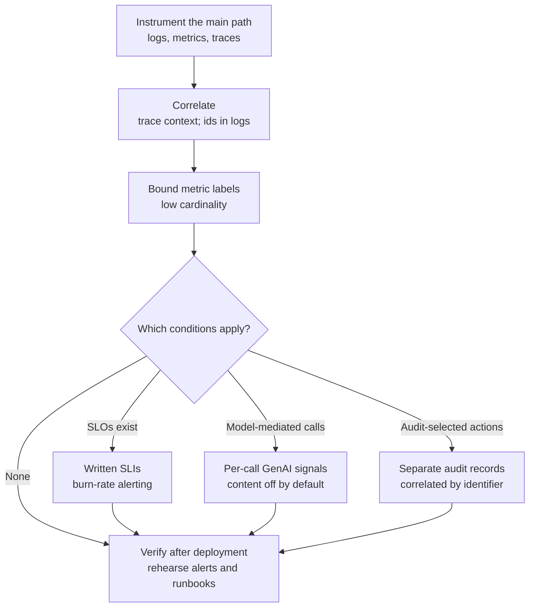

# Service Observability

This reference answers **how is a service instrumented and its telemetry verified?** It composes existing doctrine; it creates no new requirements.

If this reference conflicts with a canonical principle or owning pattern, the canonical owner wins and this reference is defective.

## Use When

Use this when instrumenting a new service, path, or feature, defining SLOs and alerts, adding model-mediated calls, or deciding which actions need audit records. For the per-endpoint shape, start from [Service API](service-api.md). For where telemetry evidence sits in the delivery graph, continue to [Testing And Verification](testing-and-verification.md).

## Standard Shape

The first three steps are the unconditional core: material paths get correlated signals with bounded labels. The branches are conditional and can combine: SLIs and burn-rate alerts only where SLOs exist, per-call GenAI telemetry only on paths that make model calls, and formal audit records only for actions the audit principle selects.

## Invariants

These summarise the canonical owners below, including their applicability and exception paths.

1. **Useful telemetry on material paths:** metrics, logs, and traces have different strengths; metrics do not replace traces. Together they suffice to debug production incidents without reproducing locally, and new features include observability in the definition of done.
2. **Correlated by default:** trace context propagates across service boundaries, and structured logs carry trace and span identifiers so logs and traces join.
3. **Low-cardinality metric labels:** labels stay to dimensions such as service, route template, and region. User, request, session, and tool-call identifiers belong in traces, logs, or exemplars.
4. **Symptom-based alerting:** alerts target symptoms tied to SLOs or imminent user impact. Pages are reserved for customer-impacting or security conditions.
5. **SLIs where SLOs exist:** each SLO has one or more SLIs with a written numerator, denominator, window, and measurement point, kept stable unless the SLO changes. Production services with SLOs normally alert on multi-window burn rate.
6. **GenAI signals only for model-mediated calls:** production and estate-governed paths serving model or agent calls emit a per-call minimum signal set joined to the trace. A service with no model calls is out of scope; exceptions follow the exception contract.
7. **Content and personal data minimised:** prompt and completion content is not captured by default; capture is opt-in, scoped, and routed through the privacy doctrine's high-risk review. Business identifiers on logs and spans stay to what support needs, preferring internal or pseudonymous references; session identifiers, tokens, credentials, keys, and payment data stay out or are masked. Retention is explicit per data category, including logs.
8. **Audit by selection, not volume:** formal audit records cover privileged, security-sensitive, policy-relevant, financially material, and externally consequential actions, or where law, contract, regulation, or an adopted control profile requires them. Audit and operational records stay separate where access, retention, integrity, or consumers differ, correlated through stable identifiers.
9. **Verified, then rehearsed:** deployment is incomplete until verification proves the service healthy enough for its intended use, and that verification normally checks that expected signals arrive, correlate, and carry the SLI data alerts depend on. Alert rules are reviewed and tested like code. Runbooks are walked on a defined cadence, and game days or chaos exercises, where run, prove rather than assume that dashboards and alerts work under partial failure.

## Normal Implementation

| Step | What the engineer does |
| --- | --- |
| Instrument | Add logs, metrics, and traces to the main path, with structured logs. |
| Correlate | Propagate trace context, populate trace and span identifiers in logs, and attach business identifiers to spans or logs for support workflows. |
| Label | Keep high-cardinality values out of metric labels. |
| Objectives | Where SLOs exist, keep each SLI's written definition with the SLO definition so duplicates do not drift. |
| Alert | Where SLOs exist, derive burn-rate thresholds from the SLO target, page fast burns, and ticket slow burns. Other non-urgent symptoms go to tickets or dashboards. |
| Protect | Prefer revocable identifiers over long-lived secrets in application logs, keep secret values out of audit entries, and set retention per data category. |
| Audit | For selected actions only, record actor, operation, resource identifier, UTC time, outcome with failure reason, and correlation where available, including denied attempts where material. Where an agent or service acts for another principal, record the delegation chain. |
| Verify | Run post-deployment verification, including telemetry arrival, trace correlation, and SLI data; validate rarely firing alerts with a known signal. [Testing And Verification](testing-and-verification.md) places these checks at deployed and scheduled surfaces. |
| Rehearse | Exercise alerts, dashboards, and runbooks non-production first, with a hypothesis, abort criteria, and recorded results. |
| Learn | The incident state document records user impact and links SLIs where available; material incidents end with tracked, owned action items. |

The objectives, burn-rate, audit, and model-call duties apply only when their condition holds; this reference adds none of them to other services.

## Common Variations

### No SLOs Yet

There are no SLIs or burn-rate alerts to define; alerts still target imminent user impact. Whether to set SLOs is a reliability decision: a focused set tied to user-visible journeys, agreed with product and stakeholders.

### Low-Traffic Service

A low-traffic service with SLOs can use a single-tier alert instead of multi-window burn rate, with the reason recorded.

### Model And Agent Calls

Each production model-mediated call carries requested and responding model with version, separate input and output token counts, percentile latency, and a cost-attribution key that feeds token budgets and spend controls. Agentic and multi-call paths add run or session correlation and per-invocation tool-call identifiers; retrieval-augmented paths link chunk and corpus identifiers on the same trace. Model identifier is an acceptable metric label. Evidence is the signal set present on sampled production traces. Attribute names and stability caveats live in tooling.

### Privileged Or Material Actions

Selected actions go to an append-only stream with tamper protection and retention proportionate to the event and any governing profile; access is least privilege. Where an estate rosters agent responders, their actions also land in the incident audit trail.

### Unexplained Regressions

When latency or CPU regressions stay unexplained after checking SLOs, deploys, and dependencies, normally profile under representative load. Continuous profiling is optional. Kernel-level probes are optional on supported Linux estates, with documented owners, overhead limits, and personal-data review.

## Boundaries

- **Collection and backends:** daemonset, sidecar, agent, or platform-managed ingestion is tooling. The owners name OpenTelemetry and W3C Trace Context as interoperability choices at boundaries, not a required product stack.
- **Audit versus operational telemetry:** ordinary state transitions can need only operational telemetry. Telemetry volume is not assurance.
- **Product analytics:** separate from security audit logs; personal data reaches analytics only with review and a contractual basis.
- **Incident operations:** severity, roles, comms, and handoff stay in the incident pattern; this reference covers their signals.
- **Numbers:** burn-rate thresholds and windows are example class, replaceable if fast burns still page and slow burns ticket.

## Canonical Doctrine

Layer contract: [Implementation References](README.md).

| Concern | Canonical principle or owning pattern |
| --- | --- |
| Useful telemetry on material paths; audit without surveillance | [Core Proposition 8](../../ENGINEERING.md#8-preserve-operability-and-learn-from-incidents) |
| Signals, correlation, identifier minimisation, cardinality, alerting, SLIs, burn rate, profiling, GenAI telemetry, and telemetry verification | [Observability](../principles/observability.md) §§1–8 |
| SLOs and game days | [Reliability: SLOs, Error Budgets, And Incidents](../principles/reliability-slo-incidents.md) §§1, 5 |
| Observability in the definition of done | [Collaboration, Trunk-Based Delivery, And Operational Rigour](../principles/collaboration.md) §8 |
| Verification after deployment | [Build Principles](../principles/build.md) §5 |
| Collection as tooling; interoperability choices | [Interoperability, Standards, And Vendor Reality](../principles/interoperability-and-standards.md) §§1, 3 |
| Audit selection, fields, integrity, and access | [Audit Logging](../principles/audit-logging.md) §§1–4 |
| Minimisation, retention, analytics separation, and content capture | [Privacy And Data Governance](../principles/privacy-and-data-governance.md) §§1–2, 4, 5.3 |
| Spend controls fed by the attribution key | [Cost, FinOps, And Unit Economics](../principles/cost-and-finops.md) §7 |
| Tool-call audit and retrieval linkage | [AI And ML-Assisted Systems](../principles/ai-ml-systems.md) §§5, 7; [RAG Retrieval Baseline](../patterns/rag-retrieval-baseline.md) §5 |
| Applicability and exceptions | [Normative Language, Applicability, And Exceptions](../patterns/normative-language-applicability-and-exceptions.md) §§3, 5 |
| State document, post-incident actions, and agent responders | [Incident Lifecycle And On-Call Operations](../patterns/incident-lifecycle-and-on-call-operations.md) §§5, 9, 10 |
| Experiments and runbook cadence | [Chaos Engineering And Game Days](../patterns/chaos-engineering-and-game-days.md) §§1–2; [Documentation And Organisational Knowledge](../principles/documentation-knowledge.md) §2 |

Tooling and verification: [Observability Tooling](../tooling/observability.md), [Platform, SRE, And Extended Readiness Checklist](../checklists/platform-readiness.md), and [Release Readiness Checklist](../checklists/release-readiness.md).

Related references: [Service API](service-api.md), [Testing And Verification](testing-and-verification.md), and [Release And Rollback](release-and-rollback.md).

Decisions and evidence: [ADR 0048](../../docs/adr/0048-add-implementation-reference-layer.md) and the [composition research note](../evolution/research-impl-backlog-batch-2-composition-2026-11.md).
